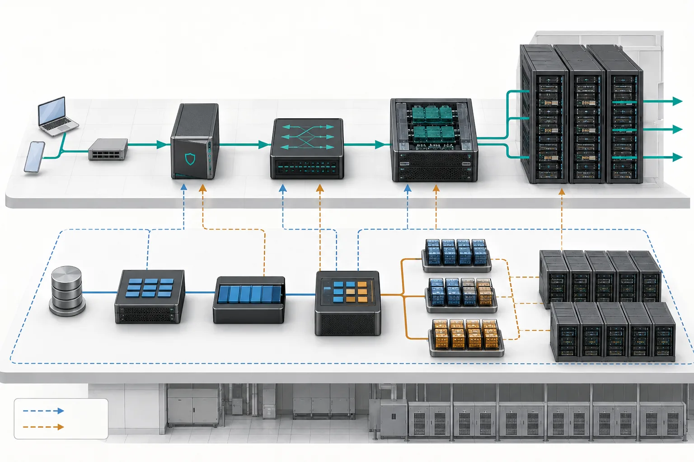
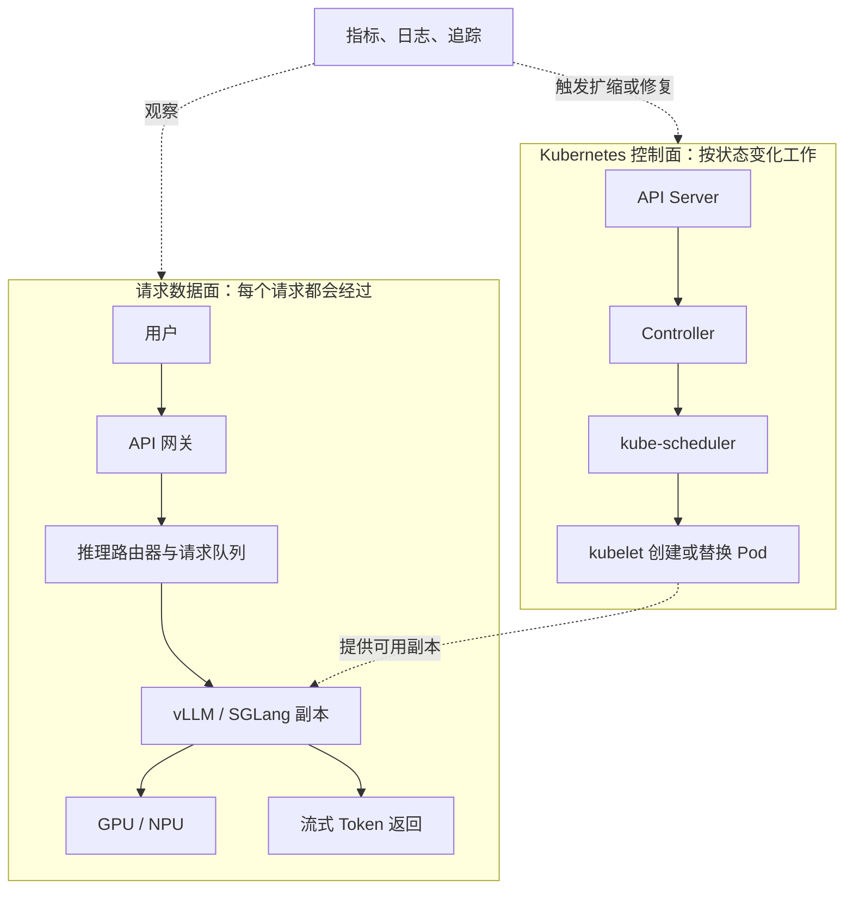
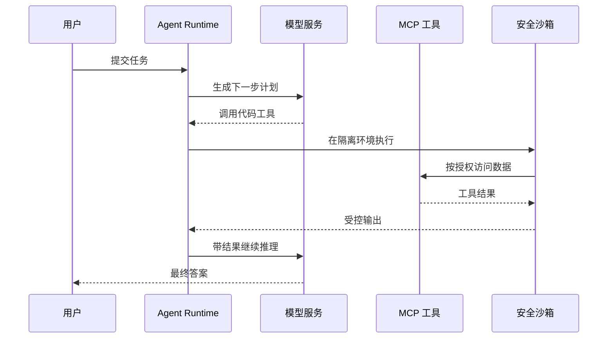
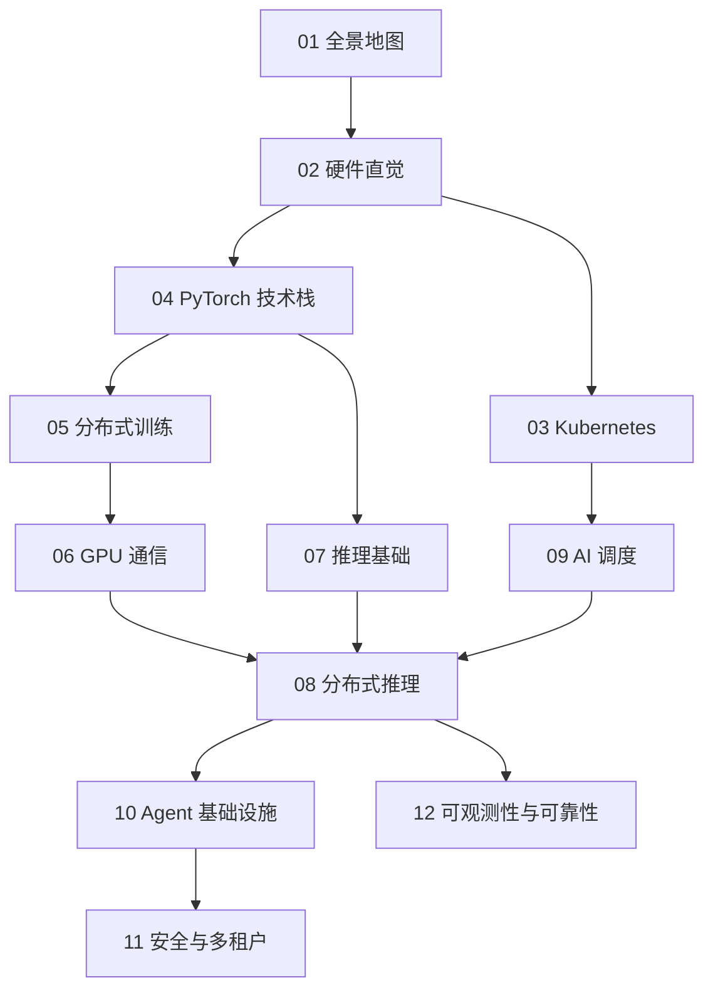
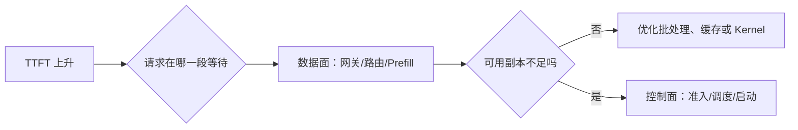

## 学习目标

读完这一篇，你不需要会部署大模型，但应该能做到三件事：

1. 看到一个项目名时，判断它处于“硬件、运行时、调度、服务还是治理”哪一层。
2. 区分训练、推理与 Agent 三种工作负载。
3. 明白后面 11 篇教程为什么按这个顺序排列。

> **一句话直觉**：AI Infra 就像一座繁忙的机场。模型是飞机，GPU 是跑道，Kubernetes 是塔台，推理引擎负责让乘客高效登机，而可观测性系统负责告诉我们堵在哪里。

<figure class="concept-figure">

<figcaption><strong>概念图：两条路径在同一数据中心协作</strong>上层是每次请求都会经过的数据面，下层是按事件持续纠偏的控制面。看图时关注：实线请求路径与虚线管理路径的节奏不同，它们不是一条串行流水线。</figcaption>
</figure>

## 一条请求的完整旅程

先把两条容易混淆的路径分开：**请求数据面**处理每一次在线请求；**Kubernetes 控制面**负责提前创建、放置和维持模型副本。正常情况下，一个 Token 请求不会先去找 kube-scheduler。只有 Pod 尚未创建、扩缩容或故障恢复时，控制面才改变数据面可用的副本。

可以把它压缩成五个问题：

| 层次 | 它回答的问题 | 论坛里的典型词 |
|---|---|---|
| 应用与入口 | 用户要做什么，身份和限额是什么？ | Agent、MCP、Gateway |
| 服务系统 | 请求交给哪个模型副本，怎样批处理？ | vLLM、SGLang、Router |
| 编排与调度 | 哪些 Pod 应该在哪些节点和 GPU 上运行？ | Kubernetes、DRA、Volcano、LWS |
| 运行时与通信 | 模型怎样变成 GPU 能执行的 Kernel？多卡怎样交换数据？ | PyTorch、Triton、NCCL |
| 硬件与治理 | 算力、显存、网络是否够用？慢和故障发生在哪里？ | GPU、NVLink、RDMA、OpenTelemetry |

## 三类工作负载不要混在一起

### 训练：修改模型参数

训练需要读取大量数据、计算梯度，并让多张 GPU 同步结果。它往往持续数小时甚至数周，最怕单卡故障让整个任务重来。因此训练重点是**并行方式、通信效率、Checkpoint 与容错**。

### 推理：使用已经训练好的模型

推理接收在线请求并生成 Token。它更在意首字延迟、每秒输出速度、并发量和每百万 Token 的成本。因此推理重点是**批处理、KV Cache、路由、弹性与性能指标**。

### Agent：让模型反复调用工具

Agent 往往不是一次模型调用。它会思考、调用 MCP 工具、执行代码、读取结果，再继续调用模型。它让推理变得更有状态，也带来不可信代码、凭据、网络访问和审计问题。

## 后续知识如何衔接

先学硬件，是因为“计算受限”和“带宽受限”会贯穿后面所有性能讨论。再学 Kubernetes 和 PyTorch，才能理解谁负责资源、谁负责执行。之后分别进入训练与推理，最后用安全、可观测性和可靠性把生产系统闭环。

<strong>先别急着背缩写</strong>论坛里项目名会很多。每听到一个新名词，先问：“它管理的是请求、Pod、模型、通信，还是硬件？”能定位层次，比记住名字重要。

## 完整案例：首字突然慢了

假设一个文档摘要服务的 TTFT 从 0.8 秒升到 4 秒。先沿数据面查：入口是否排队，路由器是否把长提示都压到同一副本，Prefill 是否变慢，模型权重是否还在加载。若发现可用副本从 8 个降到 5 个，再转向控制面：Deployment 为什么没补齐，Pod 是调度不到 GPU，还是 kubelet 拉取模型失败。

这套顺序避免两种浪费：看到延迟就盲目加 GPU；看到 Pending Pod 就误以为它解释了所有慢请求。数据面证据告诉你“用户时间花在哪”，控制面证据告诉你“服务容量为何变成现在这样”。

## 动手练习（15 分钟）

<strong>把组件放回正确平面</strong>在纸上画两条横线。把 API Gateway、kube-scheduler、vLLM、Controller、GPU Kernel、Kueue、KV Cache、kubelet 放入“请求数据面”或“集群控制面”。再用虚线连接会改变另一个平面的组件。

### 参考答案

展开参考分组

数据面：API Gateway、vLLM、GPU Kernel、KV Cache。控制面：kube-scheduler、Controller、Kueue、kubelet。kubelet 创建 vLLM Pod，Kueue/调度器决定它何时、在哪里获得资源；数据面的队列和延迟指标又可能触发控制面的扩缩容。

## 学完检查

<ul class="learning-check"><li>我能明确说出在线请求通常不经过 kube-scheduler。</li><li>我能把陌生组件先归类为请求、工作负载、运行时、硬件或治理层。</li><li>我能分别描述训练、推理和 Agent 的优化目标。</li></ul>

## 常见误区

| 误区 | 更准确的理解 |
|---|---|
| “用了 Kubernetes 就自动获得高 GPU 利用率” | Kubernetes 提供编排基础，具体利用率仍取决于队列、拓扑、批处理、缓存和模型特性。 |
| “PyTorch 就是训练框架” | PyTorch 同时覆盖模型表达、自动微分、编译、分布式和设备抽象，也参与推理执行。 |
| “Agent 只是加了工具的聊天机器人” | 生产 Agent 需要身份、沙箱、状态、工作流、审计与故障恢复，是新的基础设施工作负载。 |
| “吞吐越高，用户体验一定越好” | 大批处理通常提高吞吐，却可能让单个请求排队更久；必须同时观察延迟。 |

## 对应论坛场次

<a href="https://kubecon-cloudnativecon-openinfra-pytorch-2026.sessionize.com/session/1308539"><strong>9/8 Keynote · What AI Agents Need from Open Infrastructure</strong> 观察 Agent Runtime 如何复用 Kubernetes、Kata Containers 与沙箱生命周期。</a>
<a href="https://kubecon-cloudnativecon-openinfra-pytorch-2026.sessionize.com/session/1308448"><strong>9/9 Keynote · A Cloud Native Stack from Bare Metal to Tokens</strong> 尝试把演讲中每个组件放回本文的五层地图。</a>

### 带着这些问题听

- 演讲者所说的“平台”具体负责哪几层？
- 系统的主要瓶颈是计算、显存容量、显存带宽、网络还是排队？
- 哪个指标证明方案真的改善了用户体验或成本？
- 组件故障时，上下游分别看到什么？

## 五道自测题

1. Kubernetes 和 vLLM 谁负责决定请求进入哪个模型副本？

通常由推理网关或 vLLM 生态中的路由层决定；Kubernetes 主要负责 Pod 和设备资源的放置与生命周期。

2. 训练与推理共同依赖什么底层能力？

都依赖算力、显存、设备运行时、Kernel 和多设备通信，但优化目标不同。

3. 为什么 Agent 更需要沙箱？

因为它可能运行模型生成的不可信代码并访问外部工具，仅靠普通应用权限边界不够。

4. GPU 利用率低一定说明 GPU 不够忙吗？

不一定。采样窗口、通信等待、数据准备、KV Cache 压力和指标口径都会影响判断。

5. 遇到陌生项目名，第一步该问什么？

问它位于哪一层、管理什么对象、替代了什么旧方案。

## 延伸阅读

- [Kubernetes Concepts（官方）](https://kubernetes.io/docs/concepts/)
- [PyTorch Documentation（官方）](https://docs.pytorch.org/docs/stable/index.html)
- [论坛实时议程（Sessionize）](https://kubecon-cloudnativecon-openinfra-pytorch-2026.sessionize.com/)
