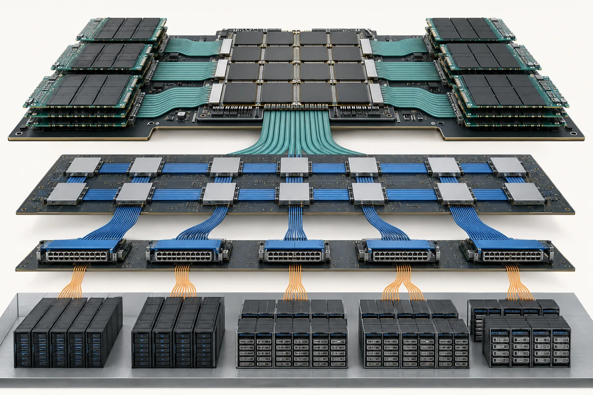
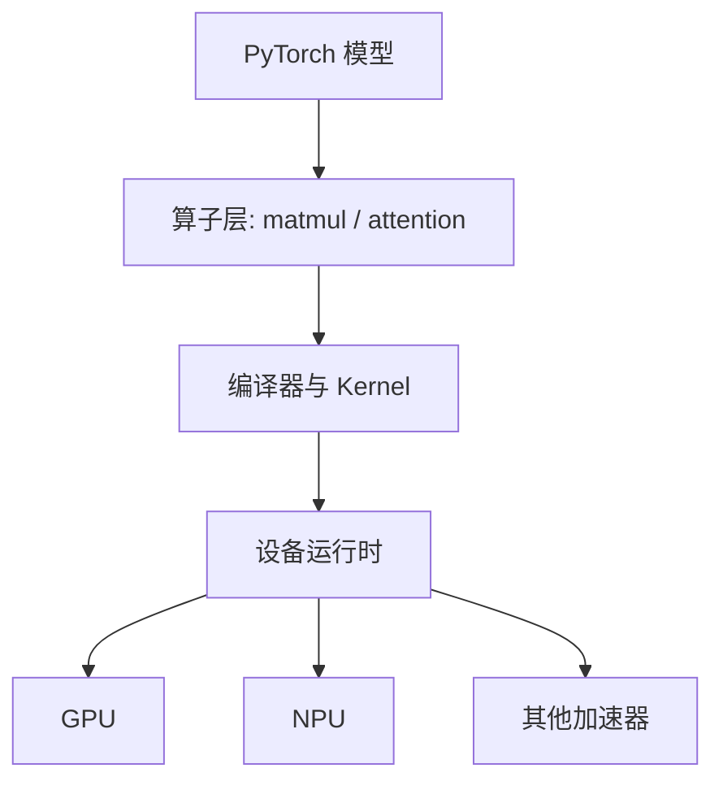
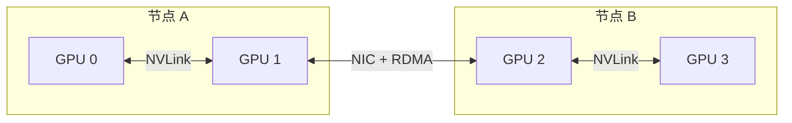

## 学习目标

读完后，你应该能解释：为什么 GPU 适合矩阵计算；显存容量和显存带宽有什么不同；为什么换一张理论算力更高的卡，程序不一定更快；“异构适配”到底在适配什么。

> **一句话直觉**：算力像厨师的切菜速度，内存容量像厨房大小，带宽像传送带速度。厨师再快，如果食材送不过来，仍然只能等。

<figure class="concept-figure">

<figcaption><strong>概念图：AI 计算首先是一套搬运系统</strong>数据要从更远、更慢的层级搬到计算单元附近，任何一层都可能成为瓶颈。看图时关注：越靠近计算单元通常越快、越小、越贵；跨服务器路径最长。</figcaption>
</figure>

## CPU、GPU 和 NPU 的分工

CPU 擅长少量复杂、分支很多的任务；GPU 擅长让大量相似计算同时进行；NPU 是对神经网络常见运算进一步专用化的加速器统称。它们不是简单的“慢、中、快”，而是工具形状不同。

| 设备 | 强项 | 常见工作 | 主要限制 |
|---|---|---|---|
| CPU | 控制逻辑、串行处理、通用性 | 数据准备、调度、Token 化 | 大规模矩阵吞吐较低 |
| GPU | 大规模并行、成熟的软件生态 | 训练、推理、科学计算 | 显存昂贵，跨卡通信复杂 |
| NPU/其他 AI 加速器 | 特定算子和数据类型效率 | 训练或推理加速 | 算子覆盖、编译器与工具生态差异较大 |

所谓“让 PyTorch 支持一种新硬件”，通常不是加一个设备名称那么简单。需要定义设备、Stream 和内存接口，补齐算子，接入编译器，处理数值精度，建立测试，并优化通信库。

## 四个性能词

### 算力：每秒能做多少计算

FLOPS 描述浮点运算吞吐。厂商给出的峰值通常需要特定数据类型、矩阵形状和理想利用率。它是天花板，不是程序实际速度。

### 显存容量：能装多少东西

模型权重、激活、梯度、优化器状态和 KV Cache 都会占显存。容量不够时，可以切分到多卡、降低精度或 Offload 到 CPU，但这些方法会增加通信或传输成本。

### 显存带宽：每秒能搬多少数据

Decode 每一步做的计算相对少，却要频繁读取模型权重和 KV Cache，因此常常是带宽受限。此时增加理论 FLOPS 可能帮助不大。

### 互联带宽：卡与卡、节点与节点搬得多快

单机内常见 PCIe、NVLink；跨机常见 InfiniBand 或 RoCE 配合 RDMA。分布式训练可能把大量时间花在梯度同步，而不是计算。

## 计算受限还是带宽受限

想象每次从仓库搬来 1 千克食材，厨师要加工 1 小时，这叫计算受限；如果只加工 1 秒，却要反复搬运 100 千克食材，这叫带宽受限。

性能工程常用 **Arithmetic Intensity** 表示“每搬一个字节做多少运算”。矩阵乘法一般更容易计算受限，逐 Token Decode 和许多逐元素算子更容易带宽受限。Roofline 模型用一条“屋顶线”展示程序被算力还是带宽限制。

<strong>先问瓶颈，再看卡型</strong>优化前先区分显存容量、显存带宽、互联带宽和计算吞吐。它们的解决方式完全不同。

## 完整案例：同一张 GPU 上的两种慢

模型 A 做长 Prompt 的 Prefill，矩阵乘法占主要时间；模型 B 做单用户长回答的 Decode，每一步都要读取权重和越来越大的 KV Cache。即使两者都显示 GPU 很忙，A 更可能受计算峰值和 Tensor Core 利用率限制，B 更可能受显存带宽限制。

假设一个 Decode 步骤读 14 GB 权重和 2 GB KV，共 16 GB；显存有效带宽若为 1.6 TB/s，光搬运的理论下限约为 `16 GB ÷ 1600 GB/s = 10 ms`。Kernel 再快也不可能突破这个搬运下限。这是**教学推导**，实际还要考虑缓存、并发、量化、通信和带宽利用率。

## 动手练习（15 分钟）

<strong>做一次瓶颈分类</strong>为下面四种现象分别选“容量、显存带宽、互联、计算”：①模型加载时报 OOM；②单卡 Decode 加更多计算单元几乎不变快；③8 卡单机快、跨两机骤降；④大矩阵 Prefill 随更高 FLOPS 明显加速。写出每项最先查看的一个指标。

### 参考答案

展开参考答案

①容量，看峰值显存与权重/激活/KV 构成；②显存带宽，看 HBM 读写吞吐与算术强度；③互联，看跨节点 Collective 时间和 NIC 路径；④计算，看 Kernel FLOPS、占用率与矩阵形状。分类是起点，最终仍要靠 Profile 验证。

## 学完检查

<ul class="learning-check"><li>我不会拿峰值 FLOPS 直接当应用速度。</li><li>我能分清显存容量、显存带宽和互联带宽。</li><li>我能用“每字节做多少运算”解释计算受限与带宽受限。</li></ul>

## GPU 共享为什么有用又危险

如果每个任务只使用一小部分显存和计算资源，让多个任务共享一张 GPU 可以减少浪费。但切得太碎会造成上下文切换、缓存竞争和延迟抖动。论坛 HAMi 场次提到“小于 1/6 的切分可能适得其反”，应追问它适用的卡型、模型和并发模式。

## 常见误区

| 误区 | 修正 |
|---|---|
| TOPS/FLOPS 越高，所有模型越快 | 还取决于精度、算子覆盖、内存和软件效率。 |
| 显存利用率高就是 GPU 利用率高 | 容量被占用不代表计算单元持续做有效工作。 |
| NPU 是一种统一架构 | NPU 是类别名，不同厂商的软件接口和能力差异很大。 |
| 跨卡和跨机通信差不多 | 跨机通常带宽更低、延迟更高，也更依赖网络拓扑。 |

## 对应论坛场次

<a href="https://kubecon-cloudnativecon-openinfra-pytorch-2026.sessionize.com/session/1312719"><strong>9/7 · Hardware-Aware AI</strong> 重点记录框架适配、算子、编译器和性能调优分别由谁负责。</a>
<a href="https://kubecon-cloudnativecon-openinfra-pytorch-2026.sessionize.com/session/1221808"><strong>9/8 14:30 · HAMi GPU Virtualization</strong> 观察共享粒度如何影响排队、利用率与成本。</a>

离线笔记：<a href="../../notes/day-1/14-00-hardware-aware-ai.md">Hardware-Aware AI</a> · <a href="../../notes/day-2/14-30-hami.md">HAMi</a>

### 带着这些问题听

- 数据是卡在显存容量、带宽、互联还是计算？
- 性能数字使用了什么精度、Batch、模型和基线？
- 一种硬件后端缺少算子时会回退、报错还是变慢？

## 五道自测题

1. GPU 为什么适合训练神经网络？

大量矩阵与张量运算结构相似，适合 GPU 的大规模并行执行。

2. 模型能装进显存，但运行仍然慢，可能缺什么？

可能缺显存带宽、互联带宽或算子效率；容量足够不代表供数速度足够。

3. Decode 为什么经常带宽受限？

每一步计算量相对较小，却要读取大量权重和历史 KV Cache。

4. RDMA 解决什么问题？

让节点间数据以较低 CPU 参与和延迟直接传输，改善跨节点通信。

5. GPU 共享的主要代价是什么？

隔离、调度和监控更复杂，也可能出现缓存竞争、抖动和性能不可预测。

## 延伸阅读

- [PyTorch Accelerator（2.14 官方文档）](https://docs.pytorch.org/docs/2.14/accelerator.html)
- [NVIDIA Deep Learning Performance Guide](https://docs.nvidia.com/deeplearning/performance/)
