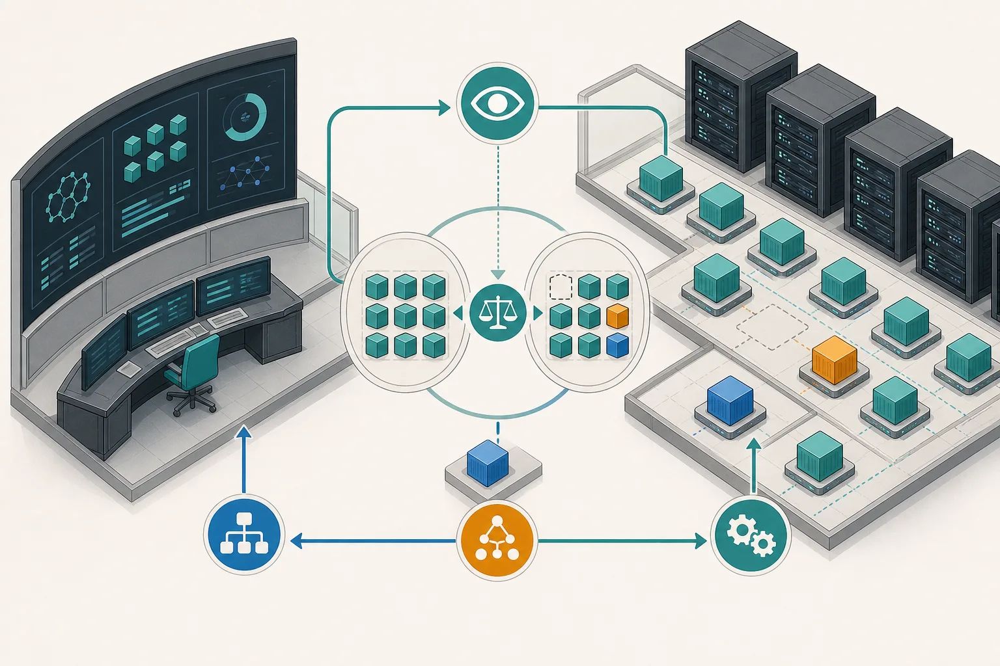
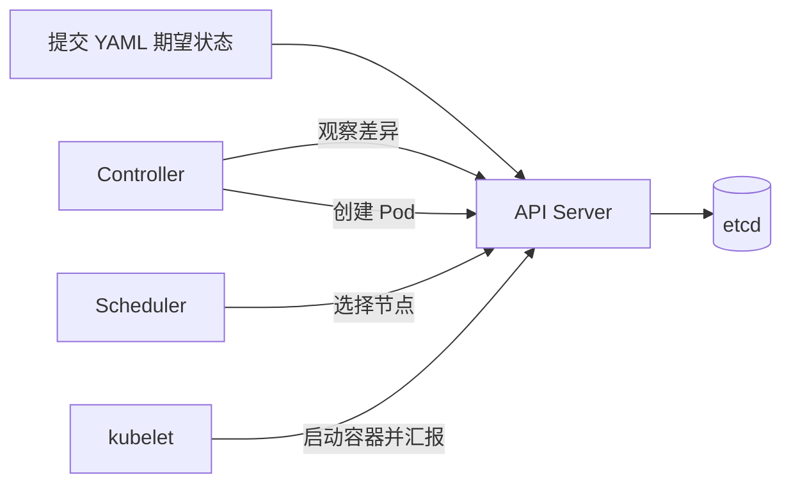
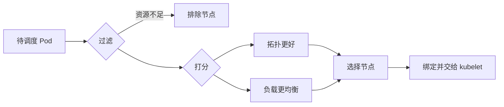

## 学习目标

理解 Kubernetes 的声明式思想、控制平面、Pod 生命周期和调度基本流程；能区分 Deployment、Job、工作流系统和队列系统。

> **一句话直觉**：Kubernetes 不是一串“启动容器”的命令，而是一群不断对账的管理员：你写下期望状态，它们持续把现实拉回期望。

<figure class="concept-figure">

<figcaption><strong>概念图：控制器的工作是持续对账</strong>期望状态与实际状态不一致时，控制器提交修正，调度器选择位置，节点代理执行。看图时关注：这是反复发生的闭环，不是从左到右只执行一次的脚本。</figcaption>
</figure>

## 核心思想：声明结果，不写操作步骤

传统脚本会说：“在节点 A 启动三个进程，失败就重启。”Kubernetes 对象则说：“我希望一直有三个符合条件的副本。”控制器反复比较期望与现实，发现少一个就补一个。

这叫 **Reconciliation Loop（调谐循环）**。理解它之后，Controller、Operator、CRD 都不再神秘：它们只是给 Kubernetes 增加新的“可对账对象”。

## 五个必须会说清的对象

| 对象 | 管什么 | AI 场景例子 |
|---|---|---|
| Pod | 一组共同调度、共享网络环境的容器 | 一个推理引擎进程 |
| Deployment | 无状态副本和滚动更新 | 普通 API 服务、单 Pod 模型副本 |
| Job | 有完成状态的一次性任务 | 数据预处理、单次训练 |
| StatefulSet | 有稳定身份和存储的副本 | 需要稳定编号的服务 |
| CRD + Controller | 自定义领域对象及其生命周期 | PyTorchJob、LeaderWorkerSet、RayCluster |

Pod 是最小调度单位，但一个大模型副本可能需要多个 Pod 和多张 GPU 协同。此时 Deployment 无法表达“这几个 Pod 必须一起获得资源”，所以会出现 LeaderWorkerSet、PodGroup 和 Gang Scheduling。

## 调度器到底做什么

创建 Pod 时，调度器先过滤不合格节点，再给候选节点打分，最后绑定一个节点。它考虑资源请求、亲和性、污点容忍、拓扑和扩展插件，但并不会自动理解“这四张 GPU 必须位于同一 NVLink 域”。复杂设备需要 DRA 或厂商插件提供更多信息。

## Kubernetes 为什么还不等于 AI 平台

原生 Kubernetes 更擅长管理独立 Pod 和通用服务。AI 工作负载还需要：

- **队列与配额**：团队间如何共享昂贵 GPU，谁先运行。
- **成组调度**：分布式任务所需资源必须一起到位。
- **拓扑感知**：GPU、NIC、NUMA、NVLink 的相对位置影响性能。
- **设备共享**：一张 GPU 如何切分，健康状态怎样上报。
- **模型与缓存感知路由**：请求应进入已有相同前缀缓存的副本。
- **工作流**：训练前后的多步骤依赖、重试和产物传递。

这些能力由 Kueue、Volcano、DRA、LWS、Argo Workflows 等补齐。

## Informer Choke 是什么

Controller 通常用 Informer 在本地缓存 Kubernetes 对象，并接收增量事件。当对象数量巨大、单个对象过大或更新频繁时，序列化、网络传输和事件处理会堵塞。论坛“每天 800 万任务”场次把同步延迟从 4 分钟降到 10 秒以内，重点应听它怎样减少元数据与控制器工作量，而不只是记住数字。

<strong>资源 request 不是实时使用量</strong>调度器依据声明的 request 做放置，而不是猜未来使用率。request 写得过大造成浪费，写得过小又会导致争抢与不稳定。

## 完整案例：一个推理 Pod 为什么一直 Pending

用户提交的 Deployment 希望有 3 个推理 Pod。Controller 发现只有 2 个，于是创建第 3 个 Pod；API Server 保存它，Scheduler 发现它请求 1 张特定 GPU，但所有匹配节点都带有未容忍的污点，于是 Pod 保持 Pending。此时 kubelet 还没有机会拉镜像或加载模型，因为 Pod 尚未绑定节点。

排查顺序应该对应控制链：先看 Pod 事件中的过滤原因，再看资源 request、亲和性/污点和 DRA Claim，绑定后才看 kubelet、镜像、卷与进程启动。把所有失败都叫“调度失败”，会把不同责任层混在一起。

## 动手练习（15 分钟）

<strong>读一段声明式意图</strong>用你熟悉的编辑器写一个简化 YAML：一个 Deployment 需要 2 个副本，每个 Pod 请求 2 CPU 和 1 个 GPU。无需真的运行。旁边写出 Deployment Controller、Scheduler、kubelet 各自会做什么，以及少一个副本时谁先发现。

### 参考答案

展开参考答案

Deployment Controller 通过 ReplicaSet 维持副本数并创建 Pod；Scheduler 为未绑定 Pod 选择满足 request 和约束的节点；目标节点 kubelet 准备容器、卷与设备并上报状态。少副本首先由控制器通过 API 状态观察到，而不是由在线请求触发。

## 学完检查

<ul class="learning-check"><li>我能讲清 API Server、Controller、Scheduler、kubelet 的接力关系。</li><li>我知道 CRD 只是新对象定义，Controller 才包含调谐逻辑。</li><li>我能区分工作负载准入、Pod 调度和请求路由。</li></ul>

## 常见误区

| 误区 | 修正 |
|---|---|
| Pod 就是一台轻量虚拟机 | Pod 是调度和共享网络的边界，容器通常仍共享宿主机内核。 |
| Controller 每次都执行完整部署脚本 | 它持续、幂等地修正当前状态与期望状态之间的差异。 |
| HPA 能直接优化 LLM 延迟 | LLM 扩缩容需要考虑加载时间、Token 指标、缓存和 P/D 不同阶段。 |
| Namespace 自动提供强安全隔离 | 它主要是组织和策略作用域，仍需 RBAC、网络策略和运行时隔离。 |

## 对应论坛场次

<a href="https://kubecon-cloudnativecon-openinfra-pytorch-2026.sessionize.com/session/1225136"><strong>9/8 11:00 · 8 Million Tasks Daily</strong> 关注控制器、Informer、Kueue 与 Volcano 在真实规模下如何配合。</a>
<a href="https://kubecon-cloudnativecon-openinfra-pytorch-2026.sessionize.com/session/1219807"><strong>9/8 16:15 · Argo Workflows for AI</strong> 区分工作流编排、Kubernetes 调度和数据隔离。</a>

离线笔记：<a href="../../notes/day-2/11-00-eight-million-tasks.md">8 Million Tasks</a> · <a href="../../notes/day-2/16-15-argo-ai.md">Argo AI</a>

### 带着这些问题听

- 规模瓶颈发生在 API Server、Informer、Scheduler 还是业务 Controller？
- 一个任务失败时，重试由哪一层负责？是否可能重复执行有副作用的步骤？
- 队列配额依据 GPU 数量、型号、时间还是 Token 成本？

## 五道自测题

1. 什么是调谐循环？

控制器持续观察当前状态，与期望状态比较，并执行幂等操作缩小差异。

2. Scheduler 与 kubelet 的分工是什么？

Scheduler 选择节点并绑定；目标节点上的 kubelet 负责实际准备并运行 Pod。

3. 为什么分布式训练不适合只用 Deployment？

它需要成组资源、角色关系、完成语义和故障协同，Deployment 主要面向独立无状态副本。

4. Namespace 是否等于虚拟机级隔离？

不是。它是逻辑作用域，需要配合策略与沙箱才能形成更强边界。

5. Informer 为什么会成为瓶颈？

对象过多、过大或更新太频繁会增加监听、缓存、序列化和处理成本。

## 延伸阅读

- [Kubernetes Concepts v1.37](https://kubernetes.io/docs/concepts/)
- [Kubernetes Scheduling](https://kubernetes.io/docs/concepts/scheduling-eviction/kube-scheduler/)
