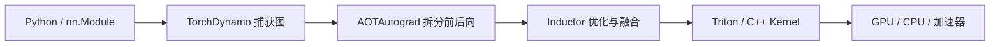
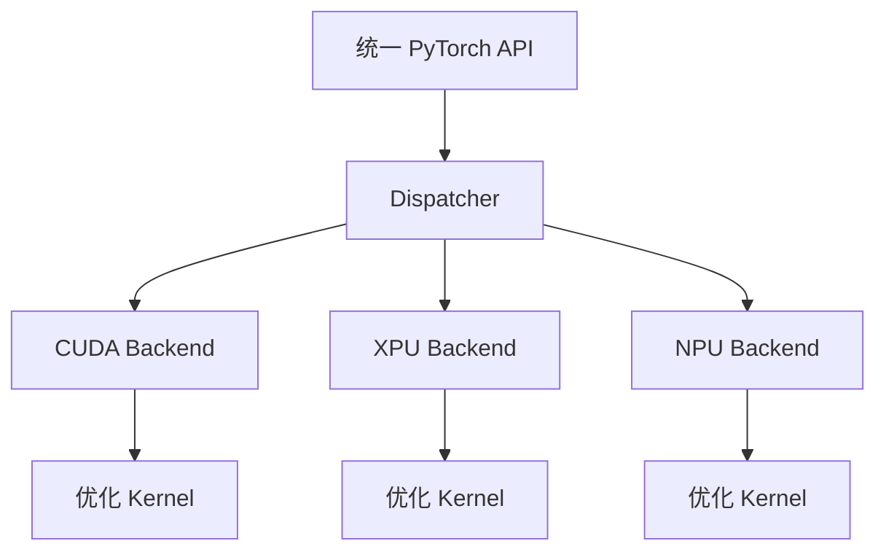

## 学习目标

能沿着一次 PyTorch 运算说清 Python API、计算图、编译、算子和 GPU Kernel；理解 `torch.compile`、Inductor、Triton 与 `torch.accelerator` 分别解决什么。

> **一句话直觉**：PyTorch 像翻译团队。你用 Python 描述想法，它先理解整句话，再改写成更高效的表达，最后交给具体硬件能执行的指令。

## 从 Eager Mode 开始

PyTorch 默认的 Eager Mode 是“写到哪，执行到哪”。它直观、便于调试，也让 Python 调度和大量小算子产生额外开销。

```python
x = torch.randn(1024, 1024, device="cuda")
y = torch.relu(x @ x.T)
```

这两行背后会创建 Tensor、选择设备实现、发射矩阵乘和 ReLU Kernel。GPU 执行通常是异步的：Python 发出工作，不代表 GPU 已经完成。因此测量时间前需要正确同步。

## 自动微分不是魔法

当 Tensor 开启梯度，PyTorch 会记录运算关系。反向传播从损失出发，沿图应用链式法则计算梯度。训练才需要这张反向图；纯推理通常关闭梯度以节省内存和开销。

## `torch.compile` 做了什么

`torch.compile` 尝试捕获 Python 程序中的 Tensor 运算，形成图并进行融合、布局和代码生成。默认后端 Inductor 再把图降低为 CPU 或加速器上的实现；GPU 场景常生成 Triton Kernel。



编译不是无条件变快。动态形状、Graph Break、编译时间和不支持的算子都可能降低收益。第一次运行通常包含编译成本，基准测试要分开看冷启动和稳态。

## 算子与 Kernel 的区别

**算子（Operator）**是语义，例如矩阵乘、Softmax、Attention；**Kernel** 是某种硬件上的具体实现。一个算子可能根据形状、数据类型和硬件选择不同 Kernel。

Triton 是用 Python 风格语言编写 GPU Kernel 的工具。它比 CUDA 更高层，但仍要求理解内存访问、并行块和硬件特性。KernelAgent 试图让 Agent 生成并根据硬件反馈优化 Triton Kernel。

## 设备无关为什么困难

PyTorch 2.14 的文档基线继续推进统一 Accelerator 接口，但“API 可以调用”只是第一步。不同设备还可能在以下方面不同：

- 支持的数据类型与数值误差；
- 算子覆盖和高性能实现；
- Stream、Event、内存分配与同步；
- 编译器后端和图优化；
- 分布式通信库；
- 测试覆盖、调试和 Profiling 工具。



统一 API 降低用户迁移成本，但不会抹掉硬件差异。真正可移植需要正确性、性能和调试能力同时成立。

## 性能分析的基本顺序

1. 先验证结果正确，并固定输入形状与精度。
2. 区分数据加载、CPU 调度、GPU Kernel 和通信时间。
3. 正确预热与同步，分别记录首次编译和稳态。
4. 找出占总时间最多的算子，而不是优化看起来最复杂的代码。
5. 改动后同时比较延迟、吞吐、显存与数值误差。

<div class="callout warning"><strong>不要用普通墙钟直接测异步 GPU</strong>如果没有同步，测到的可能只是“CPU 把任务放进队列”的时间，而不是 GPU 完成计算的时间。</div>

## 完整案例：编译后为什么反而更慢

一个模型在 Eager 模式下每次 18 ms，第一次 `torch.compile` 运行却用了 12 秒，后续输入固定形状时降到 11 ms；换成不同序列长度后又频繁重编译。这里同时存在三个数字：首次编译延迟、同一图的稳态延迟、形状变化触发的重编译成本。把它们混成一个平均值就会得出相反结论。

排查 Graph Break 时，先用官方诊断工具确认中断位置，再判断是 Python 副作用、数据相关控制流还是不支持的算子。不要为了“整图编译”改坏模型语义。<span class="source-badge">官方文档</span>`torch.compile` 的行为和诊断入口应以 PyTorch 2.14 文档为准。

## 动手练习（15 分钟）

<div class="exercise"><strong>用 CPU 建立正确的基准意识</strong>如果本机装有 PyTorch，写一个小矩阵乘函数，分别测 Eager 首次、Eager 稳态、`torch.compile` 首次和编译后稳态；每种至少运行 20 次并丢弃预热。没有 PyTorch 时，画表格设计你会记录的列：输入形状、精度、首次耗时、P50、P95、输出误差。</div>

### 参考答案

<details class="answer"><summary>展开参考答案</summary><p>合理的实验必须把编译成本与稳态分开，固定或明确列出输入形状，并先验证输出一致。CPU 上不一定变快，这不影响练习目标：你是在训练可复现测量方法，而不是证明某个后端一定更优。</p></details>

## 学完检查

<ul class="learning-check"><li>我能从 Python API 追到图捕获、Inductor 和 Kernel。</li><li>我能解释 Operator 与 Kernel 的区别。</li><li>我会分开报告冷启动、稳态性能和数值正确性。</li></ul>

## 常见误区

| 误区 | 修正 |
|---|---|
| `torch.compile` 是一个单独编译器 | 它是捕获和编排入口，后面还有 AOTAutograd、Inductor 与具体代码生成。 |
| Triton 是推理服务器 | Triton 这里指 GPU Kernel 编程语言；NVIDIA Triton Inference Server 是另一项目。 |
| 算子存在就代表性能好 | 回退实现可能正确但很慢，还需针对形状与硬件调优。 |
| 单个 Kernel 快 2 倍，模型就快 2 倍 | 端到端收益取决于该 Kernel 占总时间的比例和新增开销。 |

## 对应论坛场次

<div class="session-list">
<a href="https://kubecon-cloudnativecon-openinfra-pytorch-2026.sessionize.com/session/1209151"><strong>9/8 15:30 · KernelAgent</strong><br>关注正确性、硬件反馈、Roofline 效率和端到端收益的区别。</a>
<a href="https://kubecon-cloudnativecon-openinfra-pytorch-2026.sessionize.com/session/1222331"><strong>9/9 15:30 · Write Once, Run Anywhere</strong><br>观察 Autocast、Inductor、Graph、Stream 和测试如何统一。</a>
</div>

<p class="session-notes">离线笔记：<a href="../../notes/day-2/15-30-kernel-agent.md">KernelAgent</a> · <a href="../../notes/day-3/15-30-pytorch-generalization.md">PyTorch Generalization</a></p>

### 带着这些问题听

- 优化作用于计算图、算子选择还是 Kernel 内存访问？
- 结果包含编译时间吗？使用哪些输入形状与硬件？
- Agent 生成 Kernel 后怎样证明正确，并防止只对 Benchmark 过拟合？

## 五道自测题

<div class="quiz">
<details><summary>1. Eager Mode 的优点是什么？</summary><p>执行与 Python 代码顺序接近，直观、动态、易调试。</p></details>
<details><summary>2. `torch.compile` 为什么可能第一次更慢？</summary><p>首次运行需要捕获、分析和生成代码，之后稳态运行才可能摊薄成本。</p></details>
<details><summary>3. 算子和 Kernel 的区别是什么？</summary><p>算子描述“做什么”，Kernel 是特定硬件上“怎样执行”的实现。</p></details>
<details><summary>4. 统一 Accelerator API 是否保证相同性能？</summary><p>不保证。后端算子、编译器、通信和硬件能力仍然不同。</p></details>
<details><summary>5. 为什么 GPU 计时需要同步？</summary><p>GPU 工作通常异步提交；不同步会把排队时间误当成完成时间。</p></details>
</div>

## 延伸阅读

- [PyTorch 2.14 Documentation](https://docs.pytorch.org/docs/2.14/)
- [torch.compile 官方教程](https://docs.pytorch.org/tutorials/intermediate/torch_compile_tutorial.html)
- [PyTorch 2.14 Release](https://github.com/pytorch/pytorch/releases/tag/v2.14.0)
