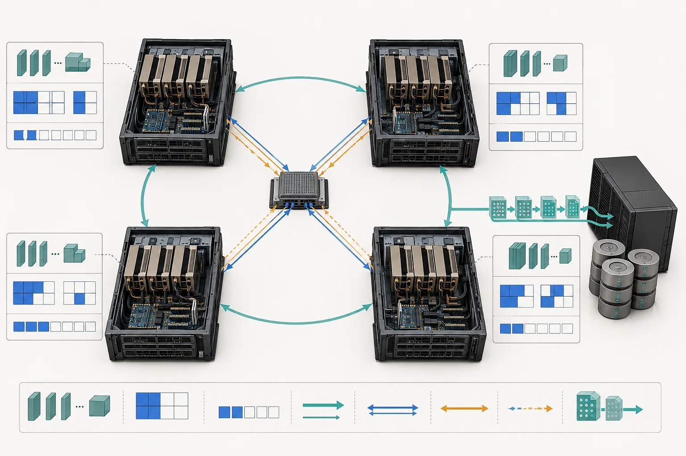
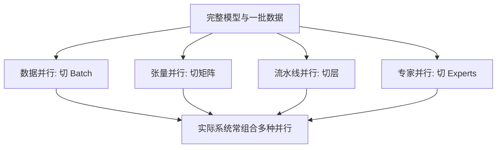
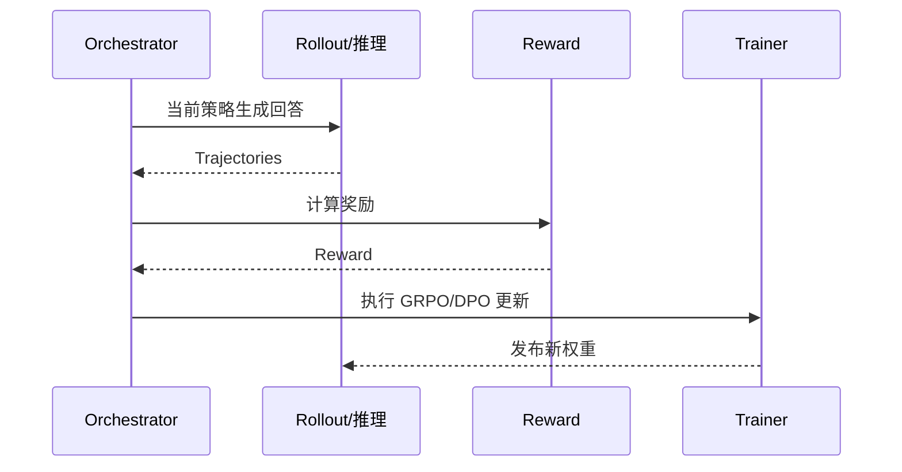
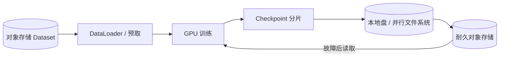

## 学习目标

能判断一种并行策略切分的是数据、模型参数、层还是专家；理解为什么大规模训练同时受显存、计算、通信和故障概率约束。

> **一句话直觉**：训练大模型像多人搬一座图书馆。可以让每个人搬不同房间的同类书，也可以把一本巨书拆开，或者把装订、质检、入库排成流水线。

<figure class="concept-figure">

<figcaption><strong>概念图：切分方式决定通信方式</strong>同一批 GPU 可以按数据、张量、层或专家分工，但每种分工会产生不同的数据交换。看图时关注：计算节点之外还有网络与存储，训练从来不只是卡内计算。</figcaption>
</figure>

## 为什么需要分布式

一张 GPU 可能遇到三个上限：模型和训练状态放不下；计算时间太长；数据规模太大。分布式不是免费扩容，每增加参与者也增加同步、等待与故障面。

## 四种并行方式

| 方式 | 切分对象 | 优点 | 代价 |
|---|---|---|---|
| 数据并行 DP | 每卡处理不同数据，模型各有一份 | 思路简单、扩展常见 | 梯度要同步，模型仍需单卡放下 |
| 张量并行 TP | 把一个大矩阵运算切到多卡 | 单层模型可突破单卡容量 | 通信频繁，依赖高速互联 |
| 流水线并行 PP | 把不同模型层放在不同卡 | 层间边界直观 | 产生 Pipeline Bubble，调度复杂 |
| 专家并行 EP | MoE 的不同专家放在不同卡 | 只激活部分参数 | Token 路由和 All-to-All 通信昂贵 |

## FSDP 在切什么

普通数据并行每个进程都保存完整参数、梯度和优化器状态。Fully Sharded Data Parallel 把这些状态切分到多个进程，需要计算某一层时再临时聚合，完成后释放或重新切分。

这样节省显存，但带来更多通信，也要求认真选择包裹粒度、预取和混合精度策略。FSDP2 强调以参数维度管理切分，接口与组合性持续演进，应以当前 PyTorch 2.14 文档为准。

## MoE 为什么参数多但计算不一定同比增加

Mixture of Experts 为每个 Token 只选择少量专家。总参数可以很大，但一次前向只激活其中一部分。难点转移到路由平衡：如果大量 Token 选择同一专家，它会拥堵；跨设备交换 Token 又会形成 All-to-All 通信。

## 强化学习训练为何更像系统工程

LLM 强化学习包含生成样本、打分、更新策略、同步权重等环节。推理引擎与训练引擎可能交替抢 GPU，长尾样本让各 worker 完成时间不同。veRL、Twinkle 等项目试图把算法组件与 GPU 编排解耦。

## 大规模训练为什么必须容错

假设单卡每天出故障的概率很低，十万张 GPU 同时工作时，集群每天仍会遇到硬件问题。传统做法让所有进程退出、从共享存储读取 Checkpoint；更先进的方法尝试缩减或扩展通信组，并把 Checkpoint 写到同伴内存或本地盘，减少恢复时间。

训练的数据与状态也有清晰的流向：Dataset 通常来自对象存储或并行文件系统，经 DataLoader 预取到 CPU，再送入 GPU；训练状态则反向写成 Checkpoint。一个可恢复 Checkpoint 不只是模型权重，还可能包括优化器、学习率调度器、随机数状态、数据读取位置和分片元数据。只保存权重，往往无法精确续跑。

<strong>扩更多卡不等于线性加速</strong>当通信、负载不均和等待占比上升时，新增 GPU 可能主要用于等待。

## 完整案例：70B 模型如何选并行

假设单卡显存放不下训练状态，8 卡单机有高速 NVLink，跨机网络明显更慢。第一步用 FSDP/FSDP2 切参数、梯度和优化器状态，先解决容量；若单层矩阵仍太大，再在单机高速域内加 Tensor Parallel；模型层数多且规模继续扩大时，再跨节点考虑 Pipeline Parallel。若是 MoE，还要把 Expert Parallel 的 All-to-All 放到拓扑较好的范围。

策略不是越多越高级。每加一个并行维度都会增加通信组、配置和恢复难度，应记录“它解决的是容量还是训练时间”以及新增通信量。

## 动手练习（20 分钟）

<strong>为四种约束选第一步</strong>①模型状态放不进单卡；②单层矩阵放不进单卡；③模型层很多且跨机带宽有限；④MoE 专家负载严重不均。分别选择 FSDP、TP、PP、EP/路由均衡中的第一项，并画出最频繁的通信发生在哪里。

### 参考答案

展开参考答案

①FSDP，以 AllGather/ReduceScatter 换显存；②TP，层内频繁通信，优先放高速互联域；③PP，把连续层分段，控制跨阶段激活传输并减少空泡；④EP 加路由均衡，关注 All-to-All 热点。真实大模型常组合，但应从最直接约束开始。

## 学完检查

<ul class="learning-check"><li>我能说出 DP、TP、PP、EP 分别切什么。</li><li>我知道 Checkpoint 与模型权重文件并非同一概念。</li><li>我会把数据读取、通信和故障恢复都纳入训练方案。</li></ul>

## 常见误区

| 误区 | 修正 |
|---|---|
| FSDP 就是张量并行 | FSDP 主要切分训练状态；张量并行切分单个算子的计算。 |
| MoE 每次都会计算所有专家 | 通常每个 Token 只路由到少数专家。 |
| Checkpoint 越频繁越安全 | 更频繁会增加 I/O 和暂停，需要权衡重算成本。 |
| 多卡训练只要网速快 | 拓扑、集合通信算法、算子重叠与负载平衡同样重要。 |

## 对应论坛场次

<a href="https://kubecon-cloudnativecon-openinfra-pytorch-2026.sessionize.com/session/1223450"><strong>9/9 11:45 · Meta 100k-GPU Fault Tolerance</strong> 关注 torchcomms、通信组伸缩和不同 Checkpoint 介质。</a>
<a href="https://kubecon-cloudnativecon-openinfra-pytorch-2026.sessionize.com/session/1222557"><strong>9/9 14:30 · veRL for Ultra-Large MoE</strong> 关注专家/序列并行、异步 RL 和训练-推理一致性。</a>

离线笔记：<a href="../../notes/day-3/11-45-meta-fault-tolerance.md">Meta 训练容错</a> · <a href="../../notes/day-3/14-30-verl-moe.md">veRL MoE</a>

### 带着这些问题听

- 使用了哪几种并行，它们分别解决容量还是速度问题？
- 通信是否与计算重叠？跨节点占比是多少？
- 故障恢复会丢多少步，恢复时间与 Checkpoint 间隔如何选择？

## 五道自测题

1. 数据并行切分什么？

各进程处理不同数据分片，通常各自保留模型副本并同步梯度。

2. 哪种并行最依赖层内高速通信？

张量并行，因为一个算子的分片需要频繁交换中间结果。

3. FSDP 为什么节省显存？

参数、梯度和优化器状态不再在每个进程完整复制。

4. MoE 的典型通信是什么？

Token 在不同专家设备间路由，经常产生 All-to-All。

5. 为什么十万卡训练必须把故障当常态？

单设备小概率乘以巨大设备数量和长运行时间后，集群级故障会频繁出现。

## 延伸阅读

- [PyTorch Distributed 2.14](https://docs.pytorch.org/docs/2.14/distributed.html)
- [PyTorch FSDP 2.14](https://docs.pytorch.org/docs/2.14/fsdp.html)
