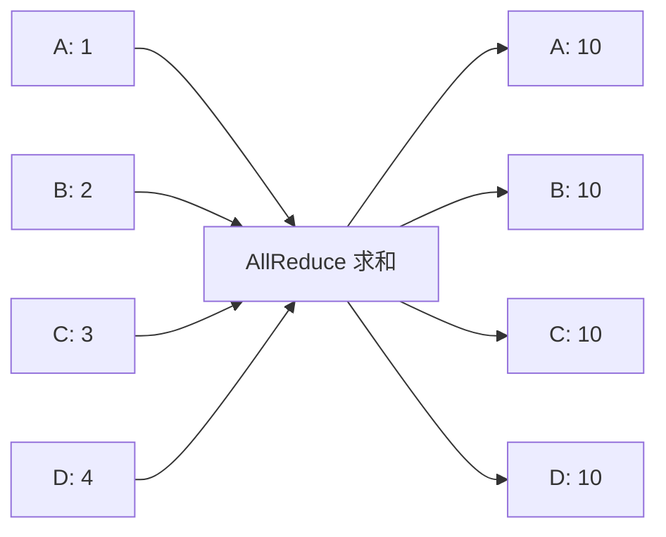
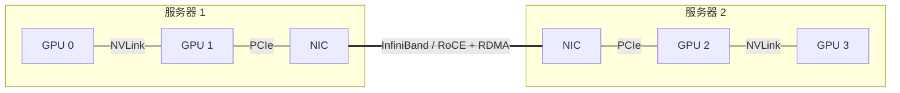

## 学习目标

能用自己的话解释四种常见 Collective；能看懂单机与跨机拓扑；知道 NCCL 是通信软件而不是网卡；理解为什么通信域故障会让整个训练挂起。

> **一句话直觉**：Collective 像多人协作整理表格，不同操作规定“每个人手里最后应得到什么”；NCCL 负责选择传递顺序和路径。

## 四种高频 Collective

假设四张 GPU 各持有一块数据：

| 操作 | 结束后每张卡拥有什么 | 常见用途 |
|---|---|---|
| Broadcast | 都得到某一张卡的同一份数据 | 发布初始参数 |
| AllReduce | 各卡数据求和/平均后，每张卡都有完整结果 | 数据并行同步梯度 |
| AllGather | 每张卡收集所有卡的不同分片 | FSDP 临时重建参数 |
| ReduceScatter | 先归约，再把结果切分给各卡 | FSDP 梯度归约与切分 |

## Ring 与 Tree

Ring AllReduce 让每张卡只与相邻卡交换数据，链路利用较均匀，适合大消息；Tree 用树形聚合与广播，步骤更少，常对小消息延迟有利。实际 NCCL 会根据拓扑、消息大小和硬件选择协议与算法，不能简单说哪一种永远更快。

## 通信路径有多层

NVLink 是 GPU 间高速互联；PCIe 连接设备与主机；InfiniBand/RoCE 是跨机网络；RDMA 是允许远端直接访问内存、减少 CPU 搬运的能力。GPUDirect RDMA 进一步减少 GPU 数据绕经主机内存的成本。

## NCCL 在做什么

NCCL 提供集合通信 API，并发现 GPU、PCIe、NIC 和网络拓扑，选择 Channel、路径、协议与算法。它可以利用 NVLink、共享内存和网络插件，但不会凭空创造带宽。

官方文档NCCL 2.31.2 是本教程制作时的官方文档版本。论坛会涉及 symmetric memory、GPU-initiated networking，以及 `ncclCommShrink`、`ncclCommGrow`、`ncclCommRevoke` 等较新容错能力。理解时应区分“API 已出现”“框架已接入”和“生产环境已验证”三个阶段。

## 为什么会死锁

Collective 要求通信组内进程按兼容顺序共同参与。如果某个 rank 崩溃、走入不同分支或卡在别的操作，其余 rank 可能永远等待。容错 API 的目标之一，是撤销旧通信域并安全形成新的成员集合，而不是让健康进程无限挂起。

<strong>通信优化的第一张图是拓扑图</strong>先画清 GPU、NUMA、PCIe Switch 和 NIC 的连接，再讨论算法。只看“网络是 400G”远远不够。

## 完整案例：为什么 8 卡正常、16 卡变慢

一个 AllReduce 基准在单机 8 卡表现正常，扩到两台 16 卡后效率骤降。不要先怪 NCCL。把路径分段：GPU 到 PCIe Switch、到 NIC、跨机 Fabric、再到另一端 GPU。若同一节点的两块 NIC 分属不同 NUMA 域，而进程和 GPU 被放在远端路径上，数据会绕路；若所有 Job 共用同一上行链路，还会出现争用。

消息大小也会改变结论。小消息更受固定延迟影响，大消息更接近带宽上限。Ring 和 Tree 的优劣必须在目标消息分布和真实拓扑上测量。

## 动手练习（15 分钟）

<strong>手算一个 Ring 直觉</strong>4 个 rank 各有 120 MB 梯度。先把它想象成 4 份，在 ReduceScatter 和 AllGather 两阶段沿环传递。无需背公式：数一数每个 rank 最终必须发送多少个“数据份”，再写出为什么链路带宽、而非全网带宽总和，决定完成时间。

### 参考答案

展开参考答案

Ring 中每阶段每个 rank 发送 3 个分片，两阶段共 6 个 30 MB 分片，即约 180 MB；常写成总数据量的 `2 × (N-1)/N`。这只是理想算法流量，不含协议开销和争用。环上最慢或被争用的链路会拖住整体。

## 学完检查

<ul class="learning-check"><li>我能描述 AllReduce、AllGather 和 ReduceScatter 的最终数据分布。</li><li>我能区分 NVLink、PCIe、RDMA 与 NCCL 的层次。</li><li>我知道正确的容错 API 名称是 ncclCommShrink、ncclCommGrow 和 ncclCommRevoke。</li></ul>

## 常见误区

| 误区 | 修正 |
|---|---|
| NCCL 只用于训练 | 推理中的张量并行、专家路由和 PD 传输也可能依赖通信。 |
| 带宽相同，通信时间就相同 | 延迟、拓扑、争用、协议与消息大小都会改变结果。 |
| AllReduce 是把数据集中到一张卡 | 它归约后让所有参与者都得到结果。 |
| 网络慢就只能升级网卡 | 还可以调整放置、并行策略、分片大小和计算通信重叠。 |

## 对应论坛场次

<a href="https://kubecon-cloudnativecon-openinfra-pytorch-2026.sessionize.com/session/1224567"><strong>9/8 13:45 · Advanced NCCL Tutorial</strong> 内容包含 symmetric memory、GIN 与 DeepEP v2；要求已有 NCCL 基础。</a>
<a href="https://kubecon-cloudnativecon-openinfra-pytorch-2026.sessionize.com/session/1223450"><strong>9/9 11:45 · Meta 100k-GPU Fault Tolerance</strong> 观察通信组如何缩减、扩展和撤销而不死锁。</a>

离线笔记：<a href="../../notes/day-2/13-45-advanced-nccl.md">Advanced NCCL</a> · <a href="../../notes/day-3/11-45-meta-fault-tolerance.md">Meta 训练容错</a>

### 带着这些问题听

- 通信发生在机内还是跨机，消息大小大约多少？
- 算法是否利用具体拓扑，拓扑变化后会怎样？
- 容错是让任务继续、快速重启，还是只更快地发现失败？

## 五道自测题

1. AllReduce 后谁得到归约结果？

通信组中的每个参与者都得到完整归约结果。

2. ReduceScatter 与 AllGather 的关系？

前者归约后分散结果，后者收集各分片；FSDP 常把它们用于不同阶段。

3. NVLink 和 RDMA 是同一类东西吗？

不是。NVLink 是设备互联；RDMA 是远端内存直接访问机制，通常运行于跨机网络。

4. Ring 是否永远优于 Tree？

不是，选择取决于消息大小、延迟、拓扑和硬件。

5. Collective 为什么容易因单进程故障而挂起？

其他成员仍等待它参与约定的通信步骤，通信域必须感知并处理成员变化。

## 延伸阅读

- [NCCL 2.31.2 User Guide](https://docs.nvidia.com/deeplearning/nccl/user-guide/docs/)
- [NCCL Collective Operations](https://docs.nvidia.com/deeplearning/nccl/user-guide/docs/usage/collectives.html)
