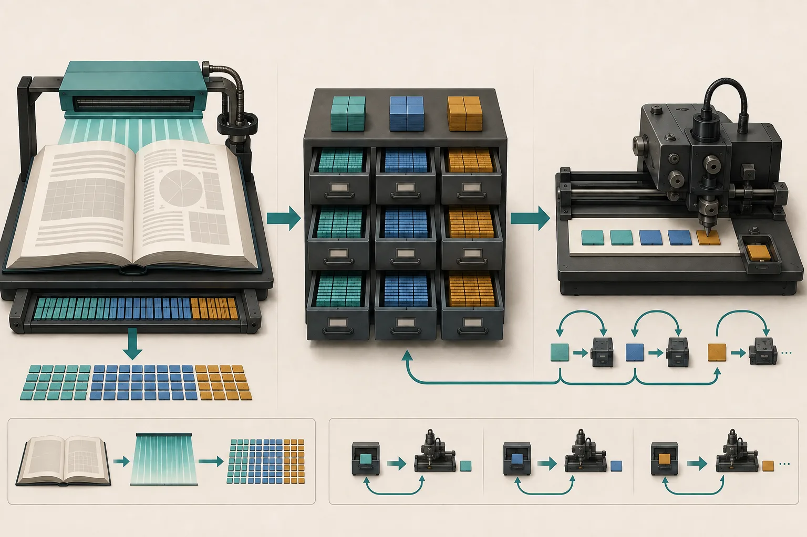
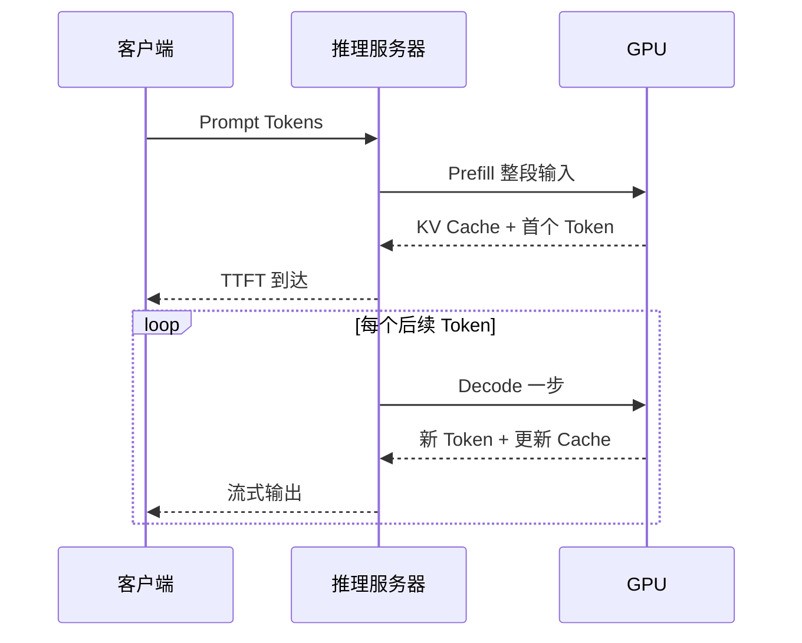

## 学习目标

能描述请求从文本到 Token、Prefill、Decode 再到流式响应的过程；会区分 TTFT、TPOT 与吞吐；理解 Continuous Batching 和 KV Cache 为什么是推理系统核心。

> **一句话直觉**：Prefill 像先读完整份材料并做笔记，Decode 像一边看笔记一边逐字写答案；KV Cache 就是那份避免反复重读的笔记。

<figure class="concept-figure">

<figcaption><strong>概念图：先整段阅读，再逐步书写</strong>Prefill 把整段输入并行处理并建立 KV，Decode 每次利用旧 KV 生成一个新 Token。看图时关注：左侧是一股宽流，右侧是反馈循环；KV 抽屉在两阶段之间持续增长。</figcaption>
</figure>

## 文本先变成 Token

模型处理的不是汉字或英文单词，而是 Token ID。一个汉字不总等于一个 Token，英文单词也可能被拆开。计费、上下文长度、缓存和输出速度通常都以 Token 为单位。

## Prefill 与 Decode

Prefill 能并行处理大量输入 Token，常更偏计算密集；Decode 每步只生成一个 Token，却反复读取权重与 KV Cache，常更受显存带宽限制。

## 三个指标

| 指标 | 定义 | 用户感受 |
|---|---|---|
| TTFT | 请求开始到第一个 Token | “多久开始回答” |
| TPOT / ITL | 后续 Token 的平均间隔 | “回答是否流畅” |
| Throughput | 单位时间系统处理的 Token 或请求 | “整个平台能服务多少人” |

总响应时间可近似为：`TTFT + (输出 Token 数 - 1) × TPOT`。这是教学近似；网络传输、客户端渲染与排队会让真实情况更复杂。

<strong>延迟组成演示</strong>
拖动数值，观察首字速度与完整响应时间为何不同。仅作教学估算。

<label>Prefill + 排队<input name="prefill" type="range" min="100" max="3000" step="100" value="800"></label>
<label>每个输出 Token<input name="decode" type="range" min="10" max="200" step="5" value="45"></label>
<label>输出 Token 数<input name="output" type="range" min="10" max="300" step="10" value="100"></label>

PrefillDecode

TTFT <b data-ttft></b><strong data-total></strong>

## KV Cache 为什么会变大

Transformer 的 Attention 需要历史 Token 的 Key 和 Value。若每生成一个 Token 都重算全部历史，成本会不断增加。缓存历史 K/V 后，只计算新 Token 部分。

KV Cache 大小大致与 `层数 × 2(K和V) × KV Heads × Head Dimension × Token 数 × Batch × 每元素字节数` 成正比。

<strong>KV Cache 显存估算器</strong>
忽略分页、对齐、量化元数据等实现差异，仅帮助形成数量级直觉。

<label>层数<input name="layers" type="number" min="1" value="32"></label>
<label>KV Heads<input name="heads" type="number" min="1" value="8"></label>
<label>Head Dimension<input name="headDim" type="number" min="1" value="128"></label>
<label>上下文 Tokens<input name="tokens" type="number" min="1" value="8192"></label>
<label>Batch<input name="batch" type="number" min="1" value="16"></label>
<label>每元素字节<select name="bytes"><option value="2">2 · FP16/BF16</option><option value="1">1 · 8-bit</option><option value="4">4 · FP32</option></select></label>

估算 KV Cache<strong data-kv-result></strong>

## Continuous Batching

静态 Batch 等整组请求全部结束再换下一组，短请求会被长请求拖住。Continuous Batching 在每个 Decode 步骤后接纳新请求、移除已结束请求，让 GPU 批次持续保持饱满。

它提高吞吐，但调度器仍要在批次大小、等待时间、显存和公平性之间取舍。大 Batch 可能让 GPU 更忙，却使单个请求排队更久。

## Prefix Caching

多个请求若共享系统提示、长文档或历史前缀，可以复用已计算的 KV Block。Agent 往往反复携带工具定义和长对话，因此命中率可能很高。但缓存也要解决哈希、隔离、淘汰、跨副本路由和 Offload 成本。

## 模型权重怎样进入 GPU

请求能到达之前，服务要先从对象存储、模型仓库或节点缓存读取权重，完成校验、反序列化、量化或格式转换，再把分片放进 CPU/GPU 内存。几十到数百 GB 的权重会让新副本经历明显冷启动。容器“Running”不等于模型“Ready”；健康检查必须等到权重加载、通信组建立和最小推理验证完成。

节点本地缓存可减少重复下载，但要处理版本、校验和、磁盘容量和淘汰。把权重缓存与 KV Cache 分开：前者跨请求共享、随模型版本变化；后者属于特定上下文，随会话和 Token 增长。

<strong>高吞吐不等于低延迟</strong>任何性能数字都要问：是单请求还是整机？平均还是 P99？输入和输出各多长？

## 完整案例：长文档问答为什么首字慢

用户提交 12k Token 文档并要求输出 200 Token。TTFT 包含入口排队、Tokenize、长 Prompt 的 Prefill，也可能包含冷副本加载权重；首字出来后，TPOT 主要由 Decode 批次、显存带宽和 KV 压力决定。若系统提示和文档前缀重复，Prefix Cache 能减少 Prefill，但第一次请求仍要完整计算。

估算器给出的 KV 是逻辑总量。使用 Tensor Parallel 时，每张卡实际持有的 KV 取决于 KV Head 如何切分；分页、对齐和运行时工作区还会增加显存。因此它是教学模型，不是容量承诺。

## 动手练习（20 分钟）

<strong>比较两个请求</strong>在上方工具中分别输入：A 为 2k 上下文、Batch 32；B 为 32k 上下文、Batch 2。记录 KV 估算和总响应时间，再把输出 Token 从 50 增到 250。回答：哪项主要推高 TTFT，哪项主要推高完整响应时间？

### 参考答案

展开参考答案

上下文增长主要增加 Prefill 和 KV；Batch 同样直接放大 KV。输出 Token 增加对 TTFT 影响很小，却按 TPOT 累加完整响应时间。生产环境还需加入排队、网络与冷启动，不能把演示数值当 Benchmark。

## 学完检查

<ul class="learning-check"><li>我能分清模型权重、KV Cache 和 Checkpoint。</li><li>我能用 TTFT、TPOT 与输出长度近似完整响应时间。</li><li>我知道 Pod Running 与模型 Ready 之间还有加载和验证阶段。</li></ul>

## 常见误区

| 误区 | 修正 |
|---|---|
| TTFT 包含整个回答时间 | 它只到首个 Token。 |
| KV Cache 缓存模型权重 | 它缓存特定序列的注意力 K/V 状态。 |
| Batch 越大越好 | 可能增加排队、显存压力和尾延迟。 |
| Tokens/s 可以跨模型直接比较 | Tokenizer、模型、输入输出长度和口径都可能不同。 |

## 对应论坛场次

<a href="https://kubecon-cloudnativecon-openinfra-pytorch-2026.sessionize.com/session/1224671"><strong>9/9 11:00 · Huawei Celia Inference Plane</strong> 听清 TTFT、吞吐与利用率分别如何变化。</a>
<a href="https://kubecon-cloudnativecon-openinfra-pytorch-2026.sessionize.com/session/1222763"><strong>9/9 15:30 · vLLM KV Cache Management</strong> 关注 Prefix Cache、CPU Offload、LRU/ARC 与 Agent 场景。</a>

离线笔记：<a href="../../notes/day-3/11-00-celia-inference.md">Celia 推理平面</a> · <a href="../../notes/day-3/15-30-vllm-kv-cache.md">vLLM KV Cache</a>

### 带着这些问题听

- 输入/输出长度、Batch 与并发是多少？
- 报告的是平均值还是 P95/P99？是否包含排队和网络？
- 缓存命中后节省计算，却增加了多少容量与传输成本？

## 五道自测题

1. Prefill 做什么？

并行处理输入上下文，建立 KV Cache，并产生第一个输出所需状态。

2. TTFT 与 TPOT 的用户感受分别是什么？

TTFT 决定多久开始回答；TPOT 决定后续文字流是否顺畅。

3. KV Cache 为什么能加速 Decode？

保存历史 Token 的注意力 K/V，避免每一步重算全部历史。

4. Continuous Batching 与静态 Batch 的区别？

它能在 Decode 步之间动态加入新请求、移除已完成请求。

5. 为什么吞吐和延迟可能冲突？

为了让 GPU 批次更满而等待更多请求，会提高整体吞吐但增加单请求排队。

## 延伸阅读

- [vLLM v0.28.0 Documentation](https://docs.vllm.ai/en/latest/)
- [SGLang v0.5.19 Documentation](https://docs.sglang.ai/)
