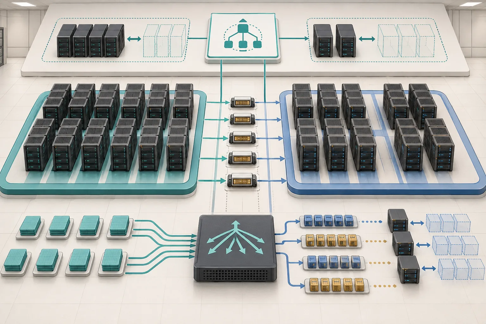
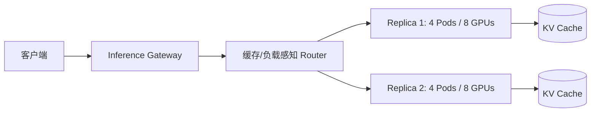
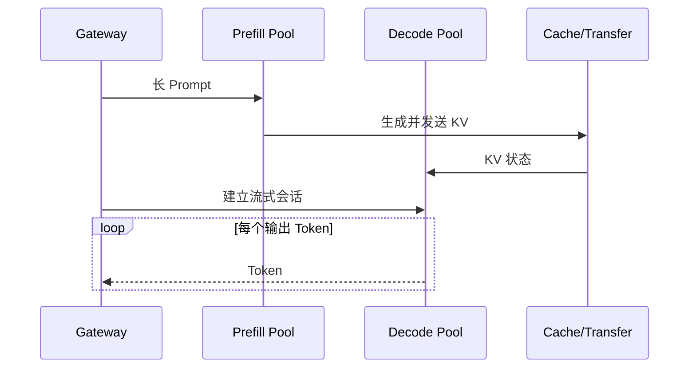

## 学习目标

能画出一个生产推理平面；理解模型副本为何可能由多 Pod、多 GPU 组成；能说清 PD 分离的收益与新增复杂度。

> **一句话直觉**：推理系统像餐厅。路由器负责领位，Batch Scheduler 负责拼桌，KV Cache 保存熟客点单记录，而 PD 分离把备菜和逐盘出餐交给不同厨房。

<figure class="concept-figure">

<figcaption><strong>概念图：两类工作池需要协同调度</strong>Prefill 池吸收宽而密集的输入，Decode 池保持稳定的逐步输出，路由器同时考虑缓存和容量。看图时关注：KV 的转移、请求的分流和副本扩缩是三件不同的事。</figcaption>
</figure>

## vLLM 与 SGLang 位于哪一层

它们是高性能模型服务运行时，负责模型加载、内存管理、请求调度、批处理和生成执行。它们不替代 Kubernetes：前者调度 Token 和 GPU Kernel，后者调度 Pod、节点和设备。

## 为什么一个副本需要多张卡

模型权重可能放不进单卡，或单卡吞吐不够。张量并行把同一层计算切到多卡；流水线并行把不同层放到不同卡。此时“一个服务副本”不再等于一个 Pod。

如果只调度到一半 Pod，已占用的 GPU 不能对外服务；如果滚动更新时成员版本不一致，通信可能失败。这就是 LeaderWorkerSet 和 Gang Scheduling 要解决的问题。

## Prefill–Decode 分离

Prefill 和 Decode 的硬件行为不同：前者通常计算密集，后者常被显存带宽限制。PD 分离让两类节点独立扩缩、放置和调优，再通过高速网络传输 KV 状态。

收益是 P/D 可以使用不同并行度、Batch 和扩缩指标；代价是 KV 传输、会话连续性、故障恢复和跨阶段可观测性更难。

## 路由不再只是看连接数

传统负载均衡常把请求发给连接少的副本。推理路由还要考虑：

- 哪个副本已有相同 Prefix Cache；
- 当前排队 Token 而非请求数；
- 模型、LoRA 和上下文是否已加载；
- 会话是否必须回到原 Decode 副本；
- GPU 内存是否足以接纳新的 KV；
- P/D 阶段是否失衡。

## HPA 为什么可能看错

CPU 使用率无法代表推理压力，GPU 利用率也可能在请求排队时仍不高。更合适的信号包括等待 Token、KV Cache 占用、TTFT、Decode 并发和每阶段队列。扩容还要考虑加载几十 GB 权重所需时间，不能等延迟爆炸后才启动。

模型制品的位置会决定扩容速度。镜像里打包权重便于版本固定，却让镜像巨大；启动时从对象存储下载更灵活，却依赖网络和仓库吞吐；节点本地缓存最快，但要防止旧版本和容量挤占。生产 Ready 条件应包含校验和、权重分片完整、通信组建立以及一次最小推理，而不只是端口已监听。

## Agent 让推理更有状态

Agent 会反复携带相同工具定义和历史，提升 Prefix Cache 价值；同时工具调用让模型连接暂时空闲但会话仍未结束。并行子 Agent 共享前缀，失败后还希望恢复上下文。这要求缓存感知路由、会话亲和和状态恢复共同工作。

<strong>PD 分离不是默认答案</strong>请求较短、规模较小或网络较慢时，KV 传输与系统复杂度可能超过收益。先证明 P/D 资源特性确实需要独立管理。

## 完整案例：缓存感知路由也会失衡

三个副本中，副本 A 因为命中热门 20k Token 前缀而不断收到新请求，缓存命中率很好，但 Decode 队列越来越长；B、C 空闲却没有该前缀。只追求缓存命中会牺牲尾延迟，只追求最短队列又会重复 Prefill。

实用路由要给“预计复用收益”和“预计等待时间”同时计分，并在 KV 快满、模型版本不同或会话绑定时设置硬约束。若 P/D 分离，还要把 KV 传输时间纳入预计成本。教学推导具体权重必须用本系统流量回放或在线实验校准。

## 动手练习（20 分钟）

<strong>设计一个路由评分表</strong>给 A、B 两个副本各写四列：等待 Token、前缀命中 Token、KV 剩余容量、模型是否已加载。自拟两组数字，先按“最短队列”选择，再按“命中节省的 Prefill 时间 - 排队时间 - KV 传输时间”选择，观察结果何时不同。

### 参考答案

展开参考思路

没有唯一公式。关键是把请求数换成 Token 工作量，并把缓存收益和排队成本放到同一时间单位。模型未加载或 KV 容量不足可作为硬性排除条件；会话中的 Decode 通常还需要亲和性。

## 学完检查

<ul class="learning-check"><li>我能区分 Kubernetes 的 Pod 调度与推理引擎的 Token 调度。</li><li>我知道 PD 分离新增了 KV 传输与会话恢复问题。</li><li>我会把模型制品加载时间纳入扩缩容，而不是只看容器启动。</li></ul>

## 常见误区

| 误区 | 修正 |
|---|---|
| 推理副本就是一个 Pod | 大模型副本可能跨多 Pod、多节点和多 GPU。 |
| 路由只需轮询 | 缓存、Token 队列、会话和模型加载状态会显著影响成本。 |
| PD 分离一定降低 TTFT | KV 传输、队列和网络不佳时可能变慢。 |
| GPU 利用率可直接驱动扩容 | 它滞后且口径有限，需要和队列、缓存、延迟组合。 |

## 对应论坛场次

<a href="https://kubecon-cloudnativecon-openinfra-pytorch-2026.sessionize.com/session/1224503"><strong>9/8 13:45 · NVIDIA Dynamo on Kubernetes</strong> 关注缓存争用、部分故障、RBG 与会话连续性。</a>
<a href="https://kubecon-cloudnativecon-openinfra-pytorch-2026.sessionize.com/session/1224671"><strong>9/9 11:00 · Huawei Celia Inference Plane</strong> 关注 P/D Workload、Router、Autoscaler 和真实流量指标。</a>
<a href="https://kubecon-cloudnativecon-openinfra-pytorch-2026.sessionize.com/session/1220647"><strong>9/9 16:15 · Why Your TTFT Lies</strong> 关注 P/D 分阶段诊断与调参动作的对应。</a>

离线笔记：<a href="../../notes/day-2/13-45-nvidia-dynamo.md">NVIDIA Dynamo</a> · <a href="../../notes/day-3/11-00-celia-inference.md">Celia 推理平面</a> · <a href="../../notes/day-3/16-15-ttft-lies.md">TTFT 诊断</a>

### 带着这些问题听

- 在什么规模和网络条件下，PD 分离才开始获益？
- Router 依据请求数、Token、缓存还是成本做决策？
- 部分副本失败时，KV 和流式会话如何恢复？

## 五道自测题

1. vLLM 与 Kubernetes 调度对象有何不同？

vLLM 主要调度请求、Token 和内存块；Kubernetes 调度 Pod、节点和设备。

2. PD 分离的核心动机？

Prefill 与 Decode 的资源特征不同，希望独立放置、扩缩和优化。

3. 为什么缓存感知路由能省成本？

把共享前缀的请求送到已有相应 KV Cache 的副本，减少重复 Prefill。

4. 普通 Deployment 对多 Pod 副本有什么不足？

难以把一组有角色关系的 Pod 作为一个原子副本管理和调度。

5. 为什么 CPU HPA 不适合直接管理 LLM？

CPU 与 Token 队列、KV 压力和 GPU 阶段瓶颈相关性弱。

## 延伸阅读

- [vLLM v0.28.0](https://github.com/vllm-project/vllm/releases/tag/v0.28.0)
- [SGLang v0.5.19](https://github.com/sgl-project/sglang/releases/tag/v0.5.19)
