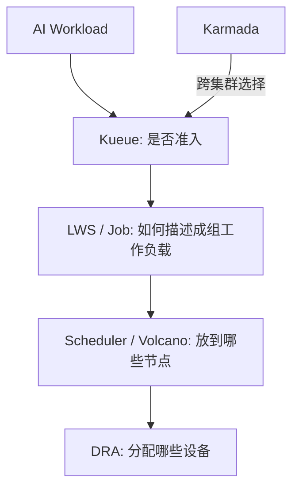
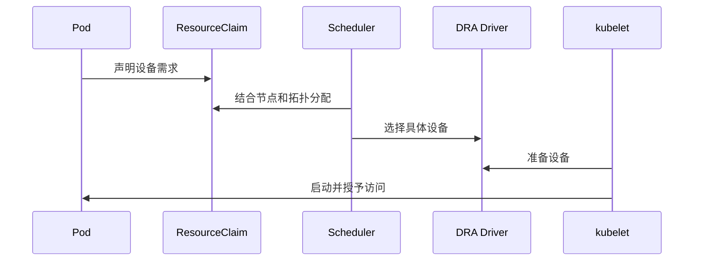

## 学习目标

理解 Device Plugin 与 DRA 的差别；知道 Kueue、Volcano、LWS、Karmada 分别在队列、调度、工作负载和多集群哪一层；能解释拓扑感知与 Gang Scheduling。

> **一句话直觉**：调度 AI 任务像安排大型乐团巡演。既要先批准预算和档期，又要让整组乐手同时到场，还要把经常合作的人安排在相邻位置，最后可能跨城市调配。

## 先把五个项目放对位置

| 组件 | 主要管理对象 | 关键问题 |
|---|---|---|
| DRA | 设备申请与分配 | 如何表达 GPU、NIC、拓扑和设备属性？ |
| Kueue | 工作负载准入与队列 | 谁现在可以占用多少资源？ |
| Volcano | Batch/AI 调度能力 | 一组任务怎样一起调度、抢占和共享 GPU？ |
| LeaderWorkerSet | 多 Pod 推理副本 | Leader 与 Worker 怎样作为一个副本管理？ |
| Karmada | 多 Kubernetes 集群 | 工作负载应放到哪个集群，怎样跨集群编排？ |

这些边界不是绝对的，项目会扩展并交叠。先问“核心 API 管理什么对象”，可以避免被产品功能列表绕晕。

## 从 Device Plugin 到 DRA

传统 Device Plugin 常把设备暴露成类似 `vendor.com/gpu: 2` 的整数资源，简单但难表达型号、显存、共享方式、NIC 关系和复杂拓扑。

DRA 让 Pod 通过 ResourceClaim 请求带属性的设备，驱动和调度器协作完成分配、准备、状态与访问控制。Kubernetes 1.37 是制作时稳定版本；论坛场次会讨论 1.36 周期内多项 DRA KEP 的架构整合。

## 队列与准入

假设研究组 A 申请 64 张 GPU、B 申请 8 张。如果直接交给默认调度器，A 可能零散占住部分 GPU 却无法启动，B 也被阻塞。Kueue 在 Pod 真正竞争资源前做工作负载准入、配额借用和公平排队。

## Gang Scheduling

分布式训练或多 Pod 推理要求全部成员一起就绪。Gang Scheduling 通过 PodGroup 等概念表达最小可运行成员数：资源不足时整组等待，避免“占一半卡却做不了工作”。

## 拓扑感知

“给我 8 张 GPU”信息太少。8 张位于同一 NVLink 域、同一节点、同一机架或跨多个数据中心，性能可能完全不同。现代调度要同时考虑 NUMA、PCIe、NVLink、NIC/Fabric 和故障域。

## GPU 共享

共享方式包括时间切片、MIG 等硬件分区、显存/算力软隔离。调度层必须知道可分配份额，运行时还要提供隔离、计量和健康状态。HAMi 试图把虚拟化、调度和监控组合起来。

## 多集群何时有必要

单集群容量或故障域无法满足需求，或不同集群拥有不同硬件时，需要跨集群编排。Karmada 管理多集群放置与策略；但跨集群并不自动形成一张低延迟 GPU 网络，训练和推理仍受数据、网络与控制面一致性约束。

<strong>不要把项目名当层次</strong>项目能力会扩展。判断集成关系时看 CRD、Scheduler Plugin、Controller 和 Driver 的实际调用路径。

## 完整案例：32 卡训练为什么占了 20 卡却不运行

团队提交一个需要 4 个节点、每节点 8 卡的训练任务。若 Pod 逐个进入默认调度，前三个节点的 24 卡可能先被占住，但第四个节点一直凑不齐 8 张符合拓扑的卡，任务无法启动。与此同时，小任务也可能因为剩余资源碎片而排队。

更合理的链路是：Kueue 先检查团队配额和整组 32 卡是否值得准入；工作负载对象描述 4 个成员的角色；Volcano 或支持 PodGroup 的调度路径执行 Gang Scheduling；DRA 在具体节点上分配满足属性和拓扑的设备。任何一层都不能单独替代其他三层。

## 动手练习（20 分钟）

<strong>为需求选组件</strong>把下面需求映射到 DRA、Kueue、Volcano/LWS、Karmada：①指定 80GB GPU 且靠近某 NIC；②两个团队按季度额度排队；③一个副本必须有 1 个 Leader 和 7 个 Worker；④上海集群满时把离线训练放到北京集群。再写出每项解决后仍未解决的一个问题。

### 参考答案

展开参考答案

①DRA，但不解决团队公平；②Kueue，但不选具体节点；③LWS 描述工作负载、Volcano/调度器负责成组放置，但不保证应用通信正确；④Karmada，但跨地域数据和网络成本仍存在。项目能力会交叠，判断依据是核心 API 和控制路径。

## 学完检查

<ul class="learning-check"><li>我能按设备、准入、成组工作负载、节点调度和多集群分层。</li><li>我能解释为什么 Gang Scheduling 减少“占了资源却不能运行”。</li><li>我不会把跨集群控制面误认为低延迟数据面。</li></ul>

## 常见误区

| 误区 | 修正 |
|---|---|
| DRA 是新的队列系统 | DRA 聚焦设备资源建模、分配和生命周期。 |
| Kueue 替代 kube-scheduler | 它主要在调度前做准入与队列管理。 |
| Gang Scheduling 提升单卡速度 | 它减少资源碎片和半组等待，不改变 Kernel 本身。 |
| 多集群等于把多地 GPU 直接拼成一台机器 | 控制面可以统一，数据面延迟和带宽仍真实存在。 |

## 对应论坛场次

<a href="https://kubecon-cloudnativecon-openinfra-pytorch-2026.sessionize.com/session/1222146"><strong>9/8 13:45 · LeaderWorkerSet</strong> 关注 LWS、PodGroup、Volcano/YuniKorn 与 DisaggregatedSet。</a>
<a href="https://kubecon-cloudnativecon-openinfra-pytorch-2026.sessionize.com/session/1223308"><strong>9/9 16:15 · Kubernetes DRA Architecture</strong> 关注设备状态、拓扑、IMEX 分配与千设备规模延迟。</a>
<a href="https://kubecon-cloudnativecon-openinfra-pytorch-2026.sessionize.com/session/1222060"><strong>9/9 16:15 · Volcano Unified Scheduling</strong> 与 DRA 同时段冲突；适合关注统一训练/推理/Agent 调度者。</a>

离线笔记：<a href="../../notes/day-2/13-45-leaderworkerset.md">LeaderWorkerSet</a> · <a href="../../notes/day-3/16-15-kubernetes-dra.md">Kubernetes DRA</a> · <a href="../../notes/day-3/16-15-volcano-scheduling.md">Volcano</a>

### 带着这些问题听

- 该组件管理的第一等对象是什么？
- 调度决策使用哪些拓扑信息，状态由谁更新？
- 资源不足、部分故障和抢占时，一组任务如何回滚或恢复？

## 五道自测题

1. Kueue 与 Scheduler 的主要分工？

Kueue 先决定工作负载何时按配额准入；Scheduler 再选择具体节点。

2. DRA 相对整数扩展资源的优势？

能表达设备属性、Claim、状态、拓扑和更完整生命周期。

3. Gang Scheduling 避免什么浪费？

避免只调度到部分成员、占住设备却无法开始工作的资源碎片。

4. LWS 主要描述什么？

由 Leader 和 Worker Pod 组成、需要作为整体管理的分布式副本。

5. Karmada 解决跨集群后，网络问题是否消失？

不会。它解决控制与放置，物理网络延迟、带宽和数据位置仍要单独处理。

## 延伸阅读

- [Kubernetes 1.37 DRA](https://kubernetes.io/docs/concepts/resource-management/dynamic-resource-allocation/)
- [Kueue 0.19](https://kueue.sigs.k8s.io/) · [LWS 0.10](https://lws.sigs.k8s.io/) · [Volcano 1.15](https://volcano.sh/en/docs/) · [Karmada 1.19](https://karmada.io/docs/)
