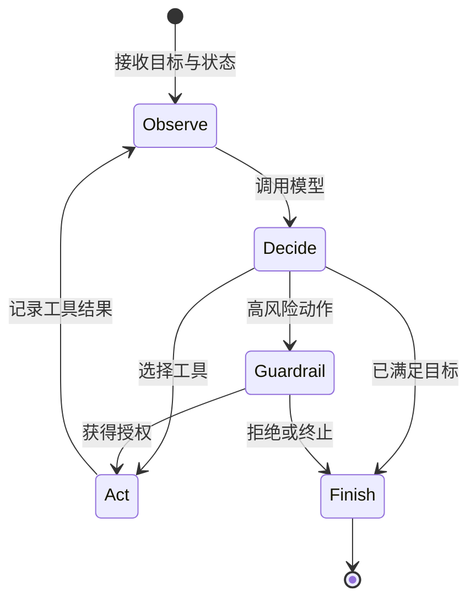
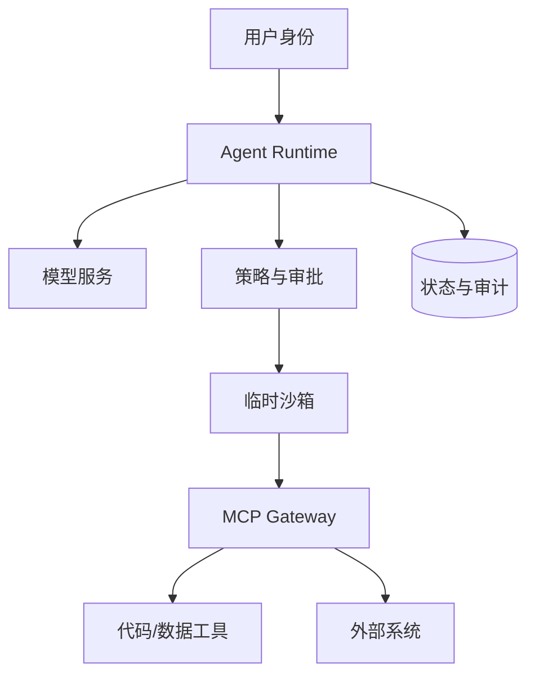

## 学习目标

区分 Agent、模型与工作流；理解 MCP 只标准化工具交互，不自动解决权限；能画出 Agent Runtime 的状态、工具、执行与审计边界。

> **一句话直觉**：模型像会提出下一步建议的大脑，Agent Runtime 像项目经理，工具是可调用的同事，沙箱是有门禁和监控的工作间。

<figure class="concept-figure">

<figcaption><strong>概念图：Agent 的能力要穿过多层边界</strong>每层只解决一种风险：策略判断、工具授权、短期身份、代码隔离和出口审计需要组合。看图时关注：沙箱位于授权之后，说明隔离环境里也不能放入无限权限。</figcaption>
</figure>

## Agent 的基本循环

普通聊天可以是一问一答；Agent 通常循环多次：观察当前状态、让模型决定下一步、调用工具、读取结果，再决定是否完成。

Runtime 要保存循环状态、限制步数和预算、处理超时重试，并在模型或工具失败时决定能否继续。

## MCP 解决什么

Model Context Protocol 为工具发现、参数描述、调用和结果返回提供共同语言。它降低每个 Agent 单独适配服务的成本。

MCP 不等于授权系统。服务器暴露一个“删除文件”工具，并不说明当前用户可以删除哪些文件；身份、最小权限、审批、审计和网络边界仍由平台实现。

## Agent 与工作流的边界

确定性工作流事先写好步骤和分支，容易审计和重放；Agent 让模型动态选择步骤，适应性更强但更难预测。生产系统常组合二者：工作流固定高层边界，Agent 只在受控步骤内做开放决策。

| 方式 | 适合 | 风险 |
|---|---|---|
| 固定工作流 | 合规审批、数据流水线、可重复操作 | 难处理未知情况 |
| 自主 Agent | 调研、开放问题、探索式编码 | 行为不可预测、成本和权限更难控 |
| 混合方式 | 企业生产 Agent | 设计和状态管理更复杂，但边界更清楚 |

## 记忆不是一个数据库名字

Agent 的“记忆”至少有三类：当前任务上下文、跨任务长期事实、执行过程与审计记录。它们的保留时间、隐私和一致性要求不同。向量数据库适合语义检索，但不能自动保证事实正确或权限隔离。

## 为什么需要沙箱

当模型生成并运行代码时，传统的“应用是可信的”假设失效。沙箱需要控制文件系统、网络、系统调用、凭据、CPU/GPU/内存和运行时间。短任务还要求快速启动和回收。

## Agent 平台的四条控制线

1. **身份线**：每个用户、Agent 实例和工具调用是谁。
2. **权限线**：它能读取、修改和发送什么。
3. **执行线**：代码在哪里运行，资源和网络如何限制。
4. **审计线**：模型决定、工具参数、结果和外部副作用能否追溯。

<strong>工具协议不等于信任</strong>标准化调用格式会让工具更容易接入，也会让危险能力更容易被调用。授权和隔离必须同时设计。

## 完整案例：重试造成两次退款

Agent 调用“创建退款”工具后网络超时，Runtime 没收到结果，于是自动重试；第一次其实已经成功，最终用户收到两笔退款。模型是否聪明与这个故障无关，问题在副作用语义。

稳健设计会给操作生成幂等键，让服务端把相同键识别为同一次动作；Runtime 保存“已发起、结果未知”的状态，不把超时等同于失败；高风险工具先进入确定性审批；审计记录用户身份、Agent 实例、工具参数摘要、幂等键和最终结果。长期记忆只能保存业务允许保留的事实，不应顺手写入密钥或完整敏感返回。

## 动手练习（15 分钟）

<strong>拆解一个订票 Agent</strong>画出“搜索车次、选择、付款、发消息”四步。标注哪些步骤可安全重试，哪些必须使用幂等键或人工确认；再为每步写出最小工具权限和超时后的状态。

### 参考答案

展开参考思路

搜索通常可重试；选择可作为本地状态；付款必须幂等并在结果未知时查询订单，不能直接再付；发消息也应使用去重键。工具只暴露完成当前步骤所需权限，付款凭据不应传给搜索沙箱。

## 学完检查

<ul class="learning-check"><li>我能分清模型、Agent Runtime、工作流和 MCP 的职责。</li><li>我会把超时看成“结果未知”，而不是自动视为失败。</li><li>我能为工具调用画出身份、权限、沙箱和审计链。</li></ul>

## 常见误区

| 误区 | 修正 |
|---|---|
| Agent 就是更长的 Prompt | 还需要状态、工具、执行、预算和失败处理。 |
| MCP 自带企业权限治理 | MCP 标准化交互，身份与授权仍需平台负责。 |
| 长期记忆越多越好 | 过期、错误或越权信息会污染决策并增加隐私风险。 |
| Namespace 足以运行不可信代码 | 常需独立内核沙箱、网络限制和身份隔离。 |

## 对应论坛场次

<a href="https://kubecon-cloudnativecon-openinfra-pytorch-2026.sessionize.com/session/1177779"><strong>9/8 13:45 · Secure Agentic Workflows</strong> 关注 MCP Gateway、SPIFFE/SPIRE 与跨 Agent 通信。</a>
<a href="https://kubecon-cloudnativecon-openinfra-pytorch-2026.sessionize.com/session/1225364"><strong>9/8 11:45 · Digital Employees at CMB</strong> 关注 Agent-as-a-Service 模板、金融护栏和数据主权。</a>

离线笔记：<a href="../../notes/day-2/13-45-secure-agentic-workflows.md">Secure Agentic Workflows</a> · <a href="../../notes/day-2/11-45-digital-employees.md">Digital Employees</a>

### 带着这些问题听

- 用户身份怎样传递到每一次工具调用？
- 哪些步骤由模型决定，哪些由确定性策略控制？
- 重试是否可能重复下单、发消息或修改数据？

## 五道自测题

1. 模型与 Agent Runtime 的分工？

模型提出或生成下一步；Runtime 管理循环、状态、工具、预算、策略和失败。

2. MCP 不解决什么？

它不自动完成用户授权、沙箱隔离、审计和业务风险判断。

3. 为什么工作流与 Agent 常组合？

工作流提供确定边界，Agent 在边界内处理开放决策，兼顾可控与适应性。

4. 长期记忆的主要风险？

错误、过期、越权和敏感信息可能被后续任务检索并影响决策。

5. Agent 重试为什么比普通 GET 请求危险？

工具调用可能有外部副作用，重复执行可能造成重复修改或交易。

## 延伸阅读

- [Model Context Protocol 官方文档](https://modelcontextprotocol.io/)
- [Kubernetes Agent Sandbox 项目](https://github.com/kubernetes-sigs/agent-sandbox)
