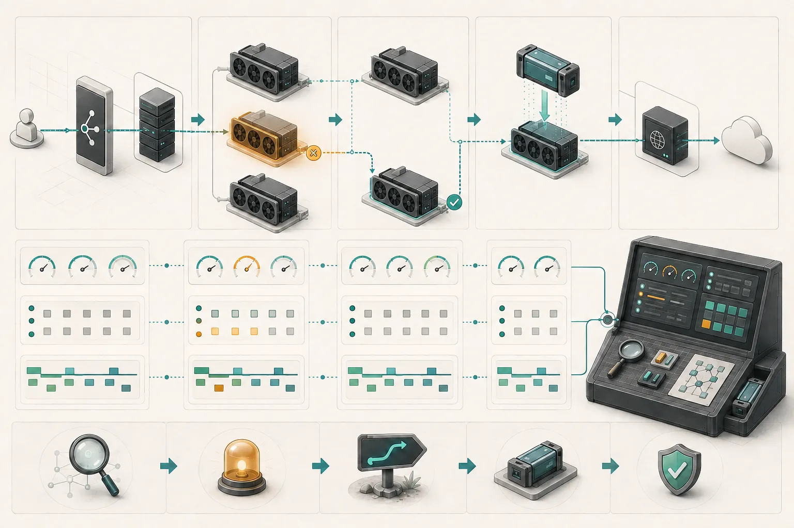
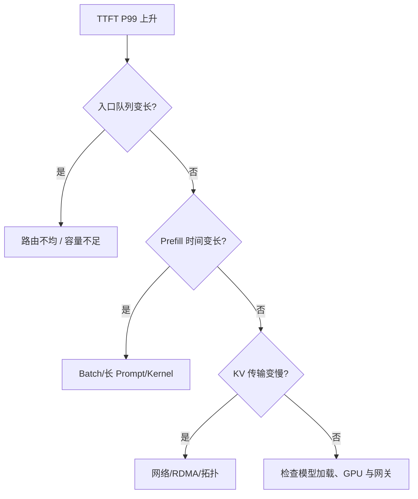
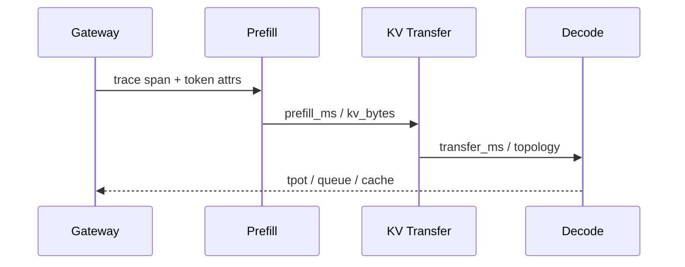

## 学习目标

区分 Metrics、Logs、Traces 和 Profiles；能从 TTFT/TPOT 异常向下定位排队、缓存、GPU 或网络；理解训练 Checkpoint 与在线推理恢复的差异。

> **一句话直觉**：监控像汽车仪表盘，只告诉你“水温高”；可观测性还要能沿着一次行程回放，判断是堵车、发动机、冷却液还是传感器出了问题。

<figure class="concept-figure">

<figcaption><strong>概念图：从用户症状沿证据链恢复</strong>先关联请求路径，再定位故障点，随后转移流量并恢复状态；告警只是第一步。看图时关注：诊断、缓解和恢复是连续动作，Checkpoint 只解决状态恢复的一部分。</figcaption>
</figure>

## 四类信号

| 信号 | 擅长回答 | AI Infra 示例 |
|---|---|---|
| Metrics | 总体趋势和告警 | TTFT P99、KV 使用率、GPU 利用率 |
| Logs | 离散事件和详细上下文 | OOM、模型加载失败、NCCL 错误 |
| Traces | 一次请求跨组件花了多久 | Gateway → Router → Prefill → Decode |
| Profiles | CPU/GPU 时间具体消耗在哪里 | 热点函数、Kernel、内存访问 |

OpenTelemetry 提供统一采集和语义约定。制作时 Semantic Conventions 最新 Release 为 1.44.0；GenAI 约定仍可能快速演进，因此字段名应按项目当前稳定性说明使用。

## 一次慢请求的因果链

只看 TTFT 无法知道哪一段慢。Trace 需要把请求 ID 和模型、Token 数、Batch、缓存命中、Prefill/Decode 实例、GPU 与网络信息关联起来。

## 经典 RED/USE 为什么不够

RED 看 Rate、Errors、Duration；USE 看 Utilization、Saturation、Errors。它们仍有价值，但 LLM 请求持续流式输出，内部有排队、Prefill、Decode、KV 与批处理。一个 HTTP 请求“成功且耗时 30 秒”可能是正常长回答，也可能是严重卡顿。

需要补充 Token 语义：输入/输出 Token、TTFT、TPOT/ITL、等待 Token、Batch、KV 命中与占用，以及每阶段错误。

## 三种常见假象

### GPU 很忙，但用户仍然慢

可能 Batch 过大、少数长请求占用资源，或 GPU 做了大量无法改善首字延迟的工作。

### GPU 不忙，但请求在排队

可能调度、数据准备、模型加载、通信同步或显存碎片阻止新请求进入，而不是算力不足。

### 平均 TTFT 正常，但投诉增加

尾延迟恶化会被平均值掩盖。应同时看 P50、P95、P99，并按模型、租户、输入长度和缓存命中拆分。

## PD 分离需要分阶段观测

如果只有端到端 TTFT，调 P:D 比例、Batch、KV Policy 或 RDMA 都像盲人摸象。跨层指标的价值不是仪表盘更多，而是能把异常直接映射到下一步行动。

## 可靠性：训练与推理不同

训练任务状态巨大、持续时间长，常通过 Checkpoint 和可变通信组恢复；在线推理请求更短，但要求流式会话、缓存和路由连续。副本失败时可以重试，但长上下文 Prefill 重算代价高，工具调用还可能有副作用。

可靠性设计要明确 RTO（多久恢复）和 RPO（允许丢多少状态），并通过故障注入验证，而不是只写架构图。

Checkpoint 还受到存储层次影响。写到同伴内存最快，但整个机架断电可能一起丢；节点本地 SSD 较快，却不能保证节点损坏后可用；并行文件系统或对象存储更耐久，但写入和恢复更慢。常见做法是分层：高频写近端、低频异步复制到耐久存储，并验证清单、分片和校验和都完整。模型权重是发布制品，训练 Checkpoint 是可恢复状态，两者不能只按文件大小混为一谈。

<strong>指标必须带上下文</strong>没有模型、Token 长度、Batch、缓存命中和硬件拓扑，单个性能数字很难解释，更无法跨系统比较。

## 完整案例：GPU 看起来正常，P99 却翻倍

平均 GPU busy 保持 75%，但长文档租户的 TTFT P99 翻倍。按租户和输入长度拆分后，只有缓存未命中的 16k+ Prompt 异常；Trace 显示入口队列正常，Prefill 耗时增加，Profile 又指向某个新 Kernel。此时结论不是“加副本”，而是回滚 Kernel 或对特定形状修复编译路径。

若同时发现一个 GPU 出现错误，先把新请求从该副本摘除，判断流式请求能否重试；训练任务则按 RTO/RPO 选择通信组缩减或从最近 Checkpoint 恢复。观测证据要能连接“症状、原因、缓解、恢复验证”四步。

## 动手练习（20 分钟）

<strong>做一次纸上事故演练</strong>选择“TTFT P99 上升”作为告警。依次写出网关、路由、Prefill、KV 传输、Decode、GPU/NIC 各一个指标或 Trace 属性；为三个可能原因写验证证据、立即缓解和长期修复。最后给训练 Checkpoint 设一个 RTO 与 RPO。

### 参考答案

展开参考框架

可用信号包括入口等待、等待 Token、输入长度、Prefill 时间、KV 字节与传输时间、TPOT、缓存占用、GPU 内存带宽和 NIC 重传。立即缓解应可回滚、可验证；长期修复要对应已证实原因。RTO/RPO 没有通用数值，但必须与 Checkpoint 间隔、写入层级和业务损失一致。

## 学完检查

<ul class="learning-check"><li>我能用 Metrics 找范围、用 Trace 找路径、用 Logs/Profiles 找细节。</li><li>我会按模型、租户、长度和缓存命中拆分尾延迟。</li><li>我能解释不同 Checkpoint 存储层级对 RTO/RPO 的影响。</li></ul>

## 常见误区

| 误区 | 修正 |
|---|---|
| 有 Prometheus 就具备完整可观测性 | 指标还需要跨层语义、Trace 关联与诊断方法。 |
| 平均延迟正常即可 | 用户问题常集中在 P95/P99 和特定租户/输入。 |
| GPU 利用率低就应减少机器 | 可能是队列、同步、数据或内存瓶颈。 |
| 自动重试总能提高可靠性 | 有副作用的工具调用可能被重复执行。 |

## 对应论坛场次

<a href="https://kubecon-cloudnativecon-openinfra-pytorch-2026.sessionize.com/session/1223860"><strong>9/9 14:30 · End-to-End Observability</strong> 关注三个生产事故如何从 Token 一直定位到 GPU。</a>
<a href="https://kubecon-cloudnativecon-openinfra-pytorch-2026.sessionize.com/session/1220647"><strong>9/9 16:15 · Why Your TTFT Lies</strong> 关注最小指标集如何映射 P:D、Batch、KV 与 RDMA 调参。</a>
<a href="https://kubecon-cloudnativecon-openinfra-pytorch-2026.sessionize.com/session/1223450"><strong>9/9 11:45 · Meta Training Through Failures</strong> 关注训练 RTO、Checkpoint 位置与动态通信组。</a>

离线笔记：<a href="../../notes/day-3/14-30-inference-observability.md">推理可观测性</a> · <a href="../../notes/day-3/16-15-ttft-lies.md">TTFT 诊断</a> · <a href="../../notes/day-3/11-45-meta-fault-tolerance.md">Meta 训练容错</a>

### 带着这些问题听

- Trace 怎样跨流式连接和 P/D 两个阶段保持关联？
- 指标是否按模型、租户、长度和缓存命中分解？
- 故障演练测出的 RTO/RPO 是多少，哪些状态必须重建？

## 五道自测题

1. Metrics 与 Traces 的主要区别？

Metrics 展示总体趋势；Trace 还原某一次请求跨组件的路径和耗时。

2. 为什么平均 TTFT 会骗人？

它会掩盖尾延迟和特定模型、长度、租户或缓存状态下的问题。

3. GPU 不忙但队列增长，可能是什么？

调度、模型加载、通信、数据准备、显存碎片等阻塞了工作进入 GPU。

4. RTO 与 RPO 分别是什么？

RTO 是目标恢复时间；RPO 是可接受的状态或数据丢失范围。

5. Agent 工具调用为何不能盲目重试？

调用可能产生外部副作用，重复执行会造成重复修改、发送或交易。

## 延伸阅读

- [OpenTelemetry GenAI Semantic Conventions](https://opentelemetry.io/docs/specs/semconv/gen-ai/)
- [Semantic Conventions v1.44.0](https://github.com/open-telemetry/semantic-conventions/releases/tag/v1.44.0)
