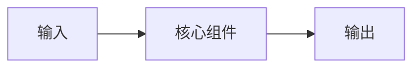

# 场次标题

- 时间 / 会场：
- 讲者 / 公司：
- 对应教程：
- 主选 / 备选：
- 同时段冲突：
- 我为什么来听：

## 会前猜想

- 我认为它解决的问题：
- 我已经知道的相关概念：
- 最想验证的问题：

## 核心架构

## 现场记录

- 原有方案及瓶颈：
- 新的抽象 / 机制：
- 关键数据与基线：
- 失败模式：
- 适用规模与前提：
- 不适用的场景：

## 量化证据

- 硬件 / 软件版本：
- 数据、模型、输入与并发：
- 基线、指标与分位数：

## 适用边界

- 成立前提：
- 明确不解决的问题：

## 待提问题

1. 问题一：
2. 问题二：

## 人物与项目

- 值得关注的人：
- 项目 / Repo / 文档：

## 会后行动

- [ ] 重画架构图
- [ ] 查证关键数字
- [ ] 阅读官方文档
- [ ] 写出三句话总结
